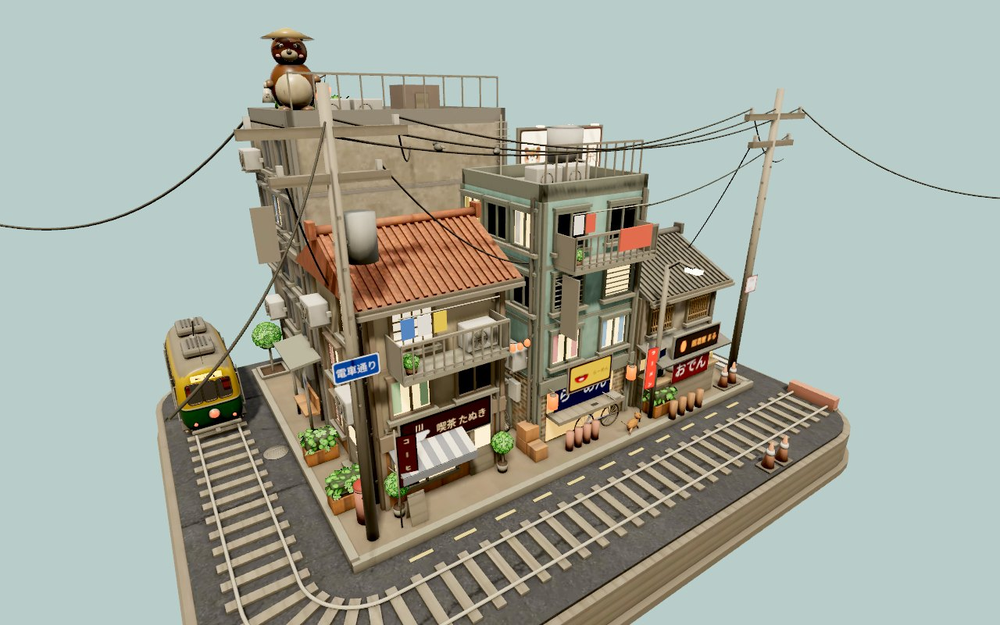
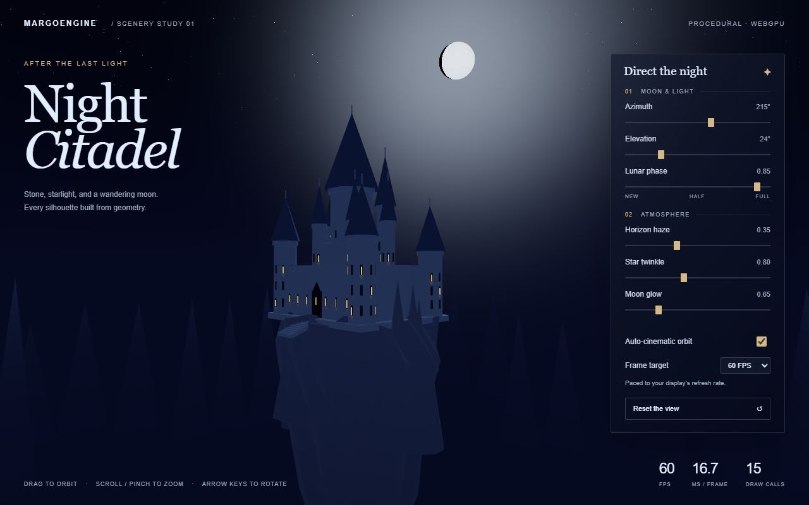
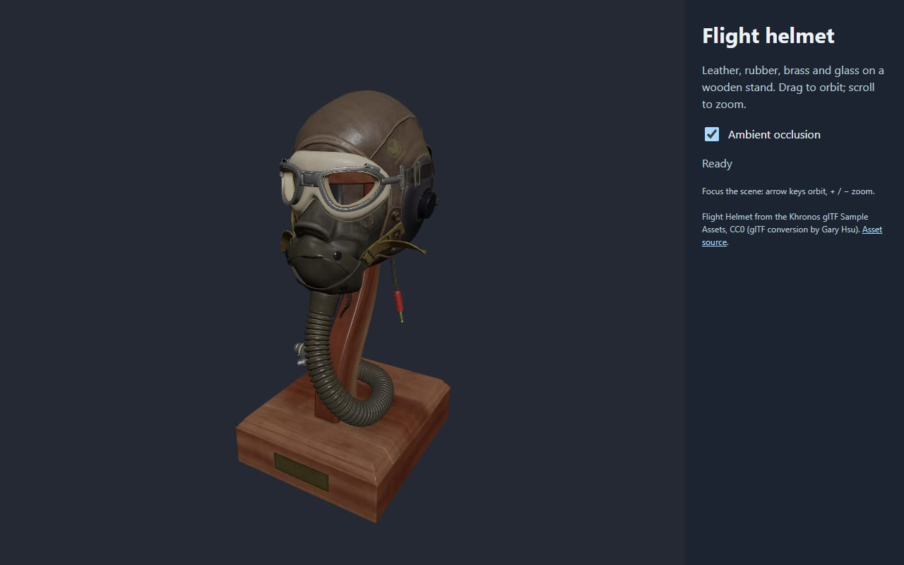
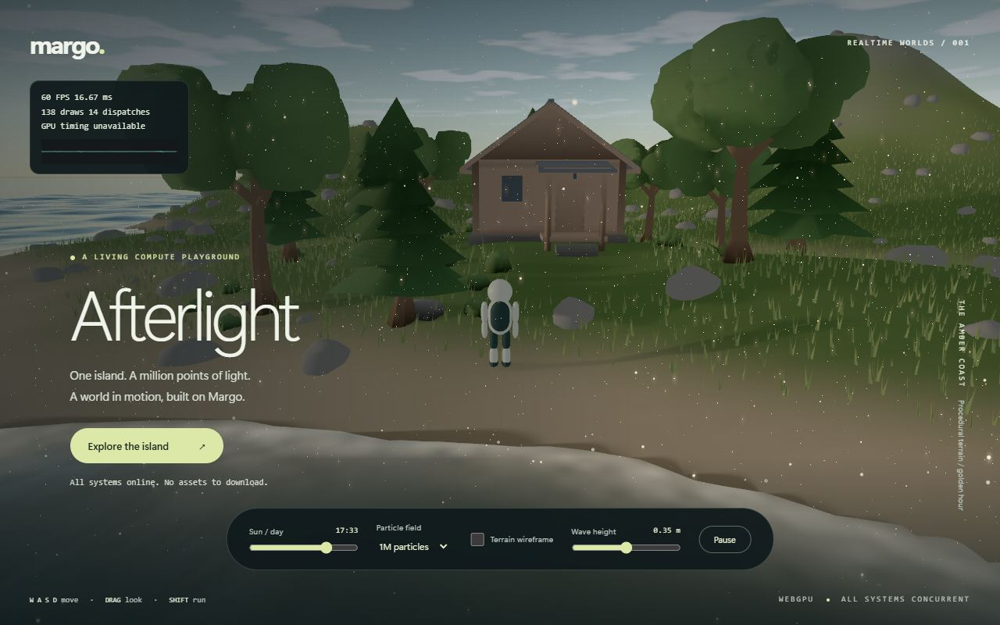

# Margo Engine

A small WebGPU engine for the web, with a Rust/Wasm core and CAD tools built on OpenCascade.

[](https://github.com/scottcampbelldata/margoengine/actions/workflows/ci.yml)
[](https://www.npmjs.com/package/margoengine)
[](LICENSE)



| | | |
| --- | --- | --- |
|  |  |  |
| [Night Citadel](apps/showcase-night-citadel/README.md) | [glTF PBR](examples/flight-helmet.html) | [Gameplay sandbox](examples/gameplay-sandbox/README.md) |

Live demos: [margoengine.com](https://margoengine.com)

The core and the stage together are 22,761 bytes gzip, Wasm kernel and WebGPU backend included. Everything else
(glTF, shadows, physics, post effects, CAD) is a separate package you import only if you use it.

## Quick start

```sh
npm install margoengine
```

```html
<div id="scene" style="height: 400px"></div>
<script type="module">
  import { createStage } from 'margoengine';

  const stage = await createStage('#scene');
  const orb = stage.sphere({ color: '#84d6bd', roughness: 0.25 });
  stage.onTick((delta) => { orb.rotation.y += delta; });
  window.addEventListener('pagehide', () => stage.dispose(), { once: true });
</script>
```

`createStage` mounts a canvas, adds orbit controls and starts rendering. Load a model with
`await stage.load('/part.glb')` (glTF, GLB, STL, OBJ, STEP and IGES).

The packages are not on npm yet. Until the first release, build from source as below and install the tarballs from
`npm run pack:packages`.

## Build from source

You need Node.js 22.12+ (or 24+) and [Git LFS](https://git-lfs.com) for the test assets.

```sh
git clone https://github.com/scottcampbelldata/margoengine.git
cd margoengine
git lfs install
git lfs pull
npm ci
npm test
```

`npm test` builds every package from the checked-in Wasm and runs the unit tests. You don't need Rust unless you
change the kernel.

```sh
npm run dev               # Night Citadel showcase
npm run dev:examples      # every page in examples/, e.g. /examples/cad-views.html
npm run lint              # Biome
npm run typecheck         # strict TypeScript for all packages
npm run test:all          # every Node test in the repo
npm run test:kernel       # Rust kernel tests (toolchain pinned in rust-toolchain.toml)
npm run measure:size      # core + stage size check
```

## Features

- WebGPU renderer with PBR, image-based lighting, cascaded shadows, clustered lights, SSAO, bloom, TAA and depth of
  field. Each one is its own package.
- Rust/Wasm transform kernel with GPU culling and instancing.
- Loaders for glTF/GLB (Draco, Meshopt, KTX2), FBX, USDZ, OBJ, STL, PLY, 3MF, COLLADA, IFC and more.
- CAD import: STEP and IGES through OpenCascade (WebAssembly, in a worker, loaded only when you use it), plus STL
  and OBJ.
- CAD tools: section planes with capped cutaways, measurement, a view cube, GPU picking and selection outlines.
- Skinning, morph targets, blend trees and IK.
- Physics on Rapier, navmesh, ECS, input and audio.
- Terrain, water, sky, procedural scenery, voxels and a progressive voxel path tracer.
- React 18 and 19 components (`@margoengine/react`).
- Optional WebGL2 fallback for basic scenes.

## Example: load a STEP file

```js
import { Engine } from 'margoengine/core';
import { loadCAD } from 'margoengine/machinery/cad';

const engine = await Engine.create(document.querySelector('canvas'));
// OpenCascade tessellates the file in a worker; the model's parts arrive as core meshes, in meters.
const model = await loadCAD(engine, '/parts/assembly.step');
console.log(model.meshes.length, 'parts');
engine.start();
```

More in [examples/](examples/README.md).

## CAD

[`@margoengine/machinery`](packages/machinery/README.md) reads STEP and IGES with
[OpenCascade](https://dev.opencascade.org/) through `occt-import-js`, compiled to WebAssembly. The importer runs in a
worker and is loaded only when a STEP or IGES file is, so it is not part of the core size. OpenCascade is LGPL-2.1
(with the Open CASCADE exception); its files ship separately in `dist/workers` and can be replaced with your own
build ([THIRD-PARTY-NOTICES.md](THIRD-PARTY-NOTICES.md)).

- STEP and IGES become core meshes with OpenCascade's surface normals; STL and OBJ load too.
- Section planes with capped cutaways, feature edges, exploded views and an assembly BVH for picking.
- Measurement: vertex, edge, face and hole anchors, distances and clearance.
- [`margo-convert`](tools/margo-convert/README.md) turns a STEP file into a GLB at build time, so a site can show it
  without loading OpenCascade.

Sizes, load times and limits are in [docs/cad-performance.md](docs/cad-performance.md) and
[docs/limits.md](docs/limits.md).

## Browser support

Margo Engine needs WebGPU. Without it, pass the `@margoengine/webgl` fallback to get a basic WebGL2 preview of plain
meshes (no textures, effects or picking).

| Browser | Status |
| --- | --- |
| Chrome and Edge (desktop) | Tested. The browser suites run in Chromium on a real GPU (Intel Arc 140V) and on SwiftShader in the manual browser workflow. |
| Safari on iPhone | Demos run, checked by hand only. |
| Safari on macOS | Has WebGPU, not tested. |
| Firefox | Not tested. |
| Android | Not tested. |

[docs/limits.md](docs/limits.md) lists the hardware these results come from and what has not been checked.

## Size

| Bundle | gzip | raw |
| --- | --- | --- |
| core + stage (`import { createStage } from 'margoengine'`) | 22,761 B | 57,642 B |

Recorded at commit `454df8f3` in [entry-sizes.json](examples/package-benchmarks/results/entry-sizes.json), along with
the size of every other package entry. `npm run measure:size` bundles the entry with Vite, minified the same way as
the package build, gzips it at the default level and prints the figure for your checkout. The build fails if
core + stage reaches 25,000 B gzip.

`npm run bench` runs the render, load, CAD, physics and memory suites with medians, p95 and machine checks. See
[docs/benchmarking.md](docs/benchmarking.md). No comparisons with other engines are published here yet.

## Architecture

```
your app
  margoengine            createStage: canvas, camera, controls, loading
  @margoengine/core      Engine, Scene, Mesh, Geometry, PbrMaterial; WebGPU renderer
    kernel (Rust/Wasm)   transforms, bounds and culling in one flat buffer
  @margoengine/*         optional packages, attached through core's extension hooks
```

Core is frozen: packages add render passes, materials and loaders through `@margoengine/core/extension` instead of
changing the base, so the base stays small and an app only pays for what it imports. The Rust source is in
`packages/kernel`; the compiled Wasm is checked in, so building the JavaScript never needs Rust.

[MODERN-ENGINE.md](MODERN-ENGINE.md) covers the architecture, lifecycle rules and limits in detail.
[docs/api-overview.md](docs/api-overview.md) is a short tour of the API.

## Packages

<!-- package-list: generated from docs/catalog.json by scripts/build-catalog.js; do not edit -->

78 packages in 10 layers, the same as the [catalog](https://margoengine.com/catalog/).

### Start here (3)

| Package | What it is |
| --- | --- |
| [`margoengine`](packages/margoengine/README.md) | Margo Engine in one install: the stage and every package as margoengine/<name> (margoengine/gltf, margoengine/shadows, margoengine/physics, margoengine/react). |
| [`@margoengine/stage`](packages/stage/README.md) | The stage: createStage mounts a canvas, camera controls and rendering in five lines. Re-exported by margoengine. |
| [`@margoengine/core`](packages/core/README.md) | WebGPU rendering and a Wasm transform kernel. WebGL2 is the optional @margoengine/webgl package. |

### Setup and diagnostics (5)

| Package | What it is |
| --- | --- |
| [`@margoengine/math`](packages/math/README.md) | Vector, quaternion, matrix, Euler, color, bounds, ray, plane and frustum math, one module per type. |
| [`@margoengine/quality`](packages/quality/README.md) | Measured quality tiers: start light, time the GPU, remember full 4x quality only where it has headroom. |
| [`@margoengine/webgl`](packages/webgl/README.md) | WebGL2 fallback renderer for browsers without WebGPU: flat-shaded PBR core meshes, opt in with Engine.create(canvas, {fallback: webglRenderer}). |
| [`@margoengine/stats`](packages/stats/README.md) | Allocation-free frame samples, DOM performance overlay and optional WebGPU timestamp profiling. |
| [`@margoengine/inspector`](packages/inspector/README.md) | Entity hierarchy, live properties, WebGPU wireframe, normal and bounding-box overlays, and a frame debugger. |

### Loading and formats (11)

| Package | What it is |
| --- | --- |
| [`@margoengine/gltf`](packages/gltf/README.md) | Lazy static glTF/GLB loading for Margo Engine. |
| [`@margoengine/gltf-pro`](packages/gltf-pro/README.md) | Opt-in glTF 2.0 metallic-roughness rendering for Margo Engine WebGPU. |
| [`@margoengine/loaders`](packages/loaders/README.md) | PLY, 3MF, PCD, OFF, XYZ, OBJ/MTL, COLLADA, Tiled TMX, legacy VTK, static USDA/USDZ, SVG and TrueType font loaders for Margo Engine. |
| [`@margoengine/decoders`](packages/decoders/README.md) | Worker-pooled Draco geometry and KTX2/Basis texture decoding, and synchronous PNG, TGA, TIFF, DDS and KTX reading, for Margo Engine. |
| [`@margoengine/fbx`](packages/fbx/README.md) | Binary and ASCII FBX conversion into the optional Margo glTF animation pipeline. |
| [`@margoengine/usdz`](packages/usdz/README.md) | Optional static USDA, USDC and USDZ ingestion through Margo glTF PBR. |
| [`@margoengine/exporters`](packages/exporters/README.md) | glTF/GLB, STL, OBJ, PLY, USDZ and COLLADA exporters for Margo Engine scenes and geometry data. |
| [`@margoengine/ifc`](packages/ifc/README.md) | IFC geometry and BIM identifiers for Margo Engine, using an initialized web-ifc runtime. |
| [`@margoengine/blender`](packages/blender/README.md) | Optional offline Blender .margo assets using Margo's WebGPU PBR renderer. |
| [`@margoengine/cache`](packages/cache/README.md) | Opt-in offline asset cache: a fetch-compatible IndexedDB cache for GLB, .bin, textures and STEP files with ETag/Last-Modified revalidation, app versioning, range requests, a byte budget with LRU eviction and network fallback. |
| [`@margoengine/splats`](packages/splats/README.md) | Optional Gaussian splats with GPU covariance projection and stable compute radix sorting. |

### Rendering and lighting (19)

| Package | What it is |
| --- | --- |
| [`@margoengine/materials`](packages/materials/README.md) | Optional glTF PBR material lobes, transmission, volume and typed node graphs through an isolated extension slot. |
| [`@margoengine/shader`](packages/shader/README.md) | Typed shader nodes that compile to readable WGSL: node materials, node post effects and node compute passes. |
| [`@margoengine/environment`](packages/environment/README.md) | HDR/EXR/UltraHDR loading, EXR writing, image-based lighting (prefiltered specular, SH irradiance, BRDF LUT), environment backgrounds and scene fog for Margo Engine on WebGPU. |
| [`@margoengine/clustered`](packages/clustered/README.md) | WebGPU clustered forward point and spot lighting with optional local shadows. |
| [`@margoengine/shadows`](packages/shadows/README.md) | Four-cascade cached directional shadows with PCSS. |
| [`@margoengine/lightmap`](packages/lightmap/README.md) | CPU lightmap atlases with native albedo, emission, normal and ORM textures; optional area lights, emissive surfaces, bounces and glass (./global) and caustics (./refracted). |
| [`@margoengine/sky`](packages/sky/README.md) | Procedural atmospheric skies, clouds, sun, moon and stars. |
| [`@margoengine/toon`](packages/toon/README.md) | Stepped diffuse shading and inverted-hull outlines. |
| [`@margoengine/oit`](packages/oit/README.md) | Weighted blended order-independent transparency for gltf-pro BLEND primitives and materials transparent meshes: no popping between overlapping transparent parts. |
| [`@margoengine/lod`](packages/lod/README.md) | Level of detail with hysteresis and screen-size switching for thousands of instances, plus GPU-baked octahedral imposters drawn in one instanced call per atlas. |
| [`@margoengine/culling`](packages/culling/README.md) | GPU-driven static instances: frustum and Hi-Z occlusion culling in compute, order-preserving compaction and indirect draws, no per-part CPU work per frame. |
| [`@margoengine/points`](packages/points/README.md) | Large point clouds (PointCloud, PointsMaterial) and instanced sprites (SpriteBatch, SpriteMaterial) for Margo Engine, WebGPU. |
| [`@margoengine/lines`](packages/lines/README.md) | Fat lines (Line, LineMaterial) and debug helpers for Margo Engine, WebGPU. |
| [`@margoengine/text`](packages/text/README.md) | GPU signed distance field text for Margo Engine: runtime glyph atlases from any browser font, wrapping, alignment, outlines and shadows, WebGPU. |
| [`@margoengine/labels`](packages/labels/README.md) | HTML labels and CSS 3D objects positioned over a Margo Engine canvas. |
| [`@margoengine/html`](packages/html/README.md) | World-space DOM anchors, CSS3D placement and scene-depth occlusion. |
| [`@margoengine/video`](packages/video/README.md) | WebGPU external video textures and optional Web Audio sampling. |
| [`@margoengine/xr`](packages/xr/README.md) | Optional WebGPU WebXR sessions, input poses and stereo rendering for Margo Engine. |
| [`@margoengine/staging`](packages/staging/README.md) | Product-shot staging: soft ground contact shadows (shadow-catcher plane) for core meshes and glTF models. |

### Post-processing (5)

| Package | What it is |
| --- | --- |
| [`@margoengine/post`](packages/post/README.md) | HDR bloom, frame-graph SSAO, GTAO, SSGI and SSR, motion blur, lens flare, SMAA and FXAA, glitch and afterimage, and post-effect stacks for Margo Engine WebGPU. |
| [`@margoengine/tonemap`](packages/tonemap/README.md) | Optional color grading: Khronos PBR Neutral (the engine default), AgX and ACES fitted curves, 2-65 cube LUTs. |
| [`@margoengine/dof`](packages/dof/README.md) | Optional two-pass WebGPU depth of field with circular bokeh. |
| [`@margoengine/taa`](packages/taa/README.md) | Optional temporal anti-aliasing with motion vectors and YCoCg history clamping. |
| [`@margoengine/transitions`](packages/transitions/README.md) | WebGPU scene wipes, noise dissolves and chromatic displacement. |

### World and effects (13)

| Package | What it is |
| --- | --- |
| [`@margoengine/terrain`](packages/terrain/README.md) | Geometry clipmaps and triplanar terrain layers. |
| [`@margoengine/voxel`](packages/voxel/README.md) | Voxel worlds: a block-type registry, 32-cubed palette chunks with light bytes, and a chunked world with dirty tracking and change events. |
| [`@margoengine/voxel-pathtracer`](packages/voxel-pathtracer/README.md) | Progressive WebGPU path tracer for instanced voxel models: diffuse, plastic, metal, glass, emissive, blended and volumetric materials, sun, sky, HDR environment and area lights, depth of field, motion blur, a denoiser and PNG capture. |
| [`@margoengine/voxel-edit`](packages/voxel-edit/README.md) | Editing voxel models for editors and tools: dense and sparse grids, modeling operations, brushes and selections, picking, export meshing, .vox scene editing and frame animation. |
| [`@margoengine/water`](packages/water/README.md) | Gerstner water surfaces, terrain-coupled shallow-water flow, foam and spray. |
| [`@margoengine/scenery`](packages/scenery/README.md) | Procedural moonlit skies and scenery passes for Margo Engine. |
| [`@margoengine/scatter`](packages/scatter/README.md) | Seeded instancing, distance-based LOD and procedural wind. |
| [`@margoengine/road`](packages/road/README.md) | Arc-length spline road surfaces, raised curbs and tiled UVs. |
| [`@margoengine/vfx`](packages/vfx/README.md) | GPU particle simulation and indirect billboards. |
| [`@margoengine/creative`](packages/creative/README.md) | WebGPU particles, atmosphere, toon shading and post-processing for Margo Engine. |
| [`@margoengine/procedural`](packages/procedural/README.md) | Procedural cabins, foliage, grass, humanoids, Marching Cubes surfaces, seeded 2D/3D/4D noise, L-systems, Voronoi fracture and a bounded voxel expression language. |
| [`@margoengine/wfc`](packages/wfc/README.md) | Seeded wave function collapse: 3D tile adjacency and the 2D overlapping (sample-based) model with backtracking. |
| [`@margoengine/splines`](packages/splines/README.md) | 3D Catmull-Rom, Bezier and Hermite curves with arc-length lookup. |

### Animation and interaction (11)

| Package | What it is |
| --- | --- |
| [`@margoengine/animation`](packages/animation/README.md) | Storage-buffer skinning and compute morph targets for Margo Engine. |
| [`@margoengine/animator`](packages/animator/README.md) | Blend trees, additive layers, animation states, foot IK and CCD IK chains. |
| [`@margoengine/kinematics-constraints`](packages/kinematics-constraints/README.md) | Standalone analytical capsule and sphere constraints for IK target and arm clearance. |
| [`@margoengine/tween`](packages/tween/README.md) | Allocation-free numeric tween updates and easing timelines. |
| [`@margoengine/cinematic`](packages/cinematic/README.md) | Critically damped camera follow, look-at and screen shake. |
| [`@margoengine/controls`](packages/controls/README.md) | Orbit, map, trackball, arcball, fly, first-person, pointer-lock and collision-aware walkthrough (/walk) camera controls, a transform gizmo and drag controls for Margo Engine. |
| [`@margoengine/cameras`](packages/cameras/README.md) | Orthographic projection and exactly vertical (top-down) views for the core camera, with matching culling and picking. |
| [`@margoengine/input`](packages/input/README.md) | Semantic keyboard, pointer, gamepad and touch actions with haptics. |
| [`@margoengine/viewcube`](packages/viewcube/README.md) | CAD view cube: shows the camera orientation and animates to top, front, side and isometric views, with a perspective/orthographic toggle. |
| [`@margoengine/selection`](packages/selection/README.md) | GPU picking and visible mesh selection outlines. |
| [`@margoengine/audio`](packages/audio/README.md) | Web Audio listener, global and positional sounds and a frequency analyser for Margo Engine. |

### Simulation and games (6)

| Package | What it is |
| --- | --- |
| [`@margoengine/physics`](packages/physics/README.md) | Rigid-body physics for Margo Engine on Rapier: fixed-step engine plugin with interpolation, colliders, joints, queries, events and a character controller. |
| [`@margoengine/navmesh`](packages/navmesh/README.md) | Convex polygon navigation with A*, funnel paths and ORCA avoidance; navmesh generation from triangles (./build). |
| [`@margoengine/ecs`](packages/ecs/README.md) | Typed-array packed sparse-set entity component storage. |
| [`@margoengine/fsm`](packages/fsm/README.md) | Hierarchical state transitions with cross-fade progress. |
| [`@margoengine/net`](packages/net/README.md) | Hermite and quaternion snapshot interpolation with bounded prediction. |
| [`@margoengine/voxel-net`](packages/voxel-net/README.md) | Multiplayer voxel worlds: an authoritative Node server on a hand-written WebSocket, a browser client with prediction and correction, and headless bots for load tests. |

### CAD and engineering (4)

| Package | What it is |
| --- | --- |
| [`@margoengine/machinery`](packages/machinery/README.md) | Kinematics, polygonal CAD ingestion, sections and metrology for Margo Engine. |
| [`@margoengine/bvh`](packages/bvh/README.md) | Triangle BVH, spatial queries and an engine Raycaster for Margo Engine. |
| [`@margoengine/geometry`](packages/geometry/README.md) | Pure-CPU, tree-shakable geometry for Margo Engine: primitives, curves, shapes, extrusion, triangulation and mesh utilities. |
| [`@margoengine/mesh-edit`](packages/mesh-edit/README.md) | Pure polygon editing with retained corner UVs, explicit topology provenance and conservative cleanup. |

### Frameworks (1)

| Package | What it is |
| --- | --- |
| [`@margoengine/react`](packages/react/README.md) | React 18/19 components and stable mesh refs for Margo Engine. |

<!-- /package-list -->

## Roadmap

- Publish 1.0.0 to npm.
- A fuller WebGL2 fallback ([docs/webgl2-compat-roadmap.md](docs/webgl2-compat-roadmap.md)).
- Testing on more hardware: Apple silicon, AMD, Android, Firefox and macOS Safari.
- Published benchmark comparisons with their method and raw results.

## Contributing

Issues and pull requests are welcome. [CONTRIBUTING.md](CONTRIBUTING.md) covers setup, tests and what a good pull
request looks like. Please follow the [code of conduct](CODE_OF_CONDUCT.md), and report security issues as described
in [SECURITY.md](SECURITY.md).

## License

[Apache-2.0](LICENSE) (see also [NOTICE](NOTICE)). Third-party code and assets keep their own licenses; see
[THIRD-PARTY-NOTICES.md](THIRD-PARTY-NOTICES.md).

Made by Scott Campbell. [margoengine.com](https://margoengine.com)
