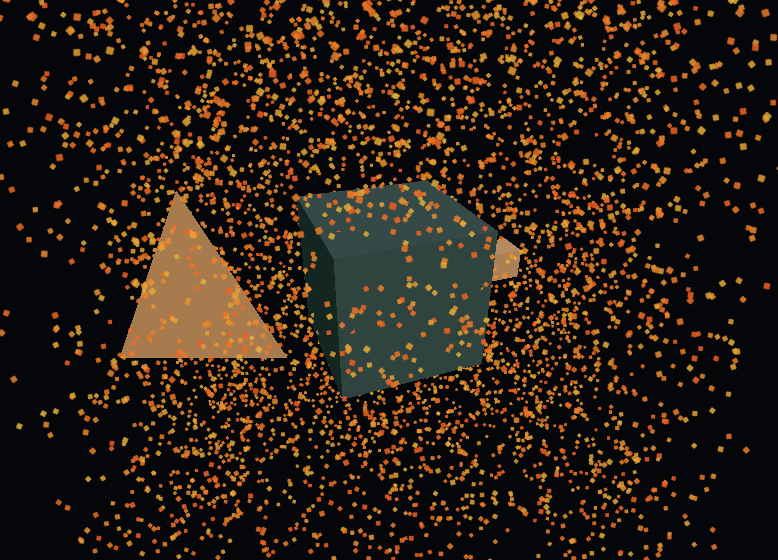

# Vexel

**A small 3D engine for the web, with a Rust and WebAssembly core, WebGPU rendering, a WebGL2 fallback and plain React components.**

**Status:** 0.1.0, published on npm. Tested in Chromium-based browsers only. No textures, shadows or animation yet. The API may change before 1.0.



*The default scene of the Vite starter. Software-rendered with SwiftShader in headless Chrome, so expect hardware GPU output to look different.*

Vexel keeps transforms, hierarchy and culling in a Rust kernel of 12 KB of Wasm, and leaves asset loading and GPU commands to TypeScript. The core package, including the embedded Wasm and both rendering backends, is 19,874 bytes gzipped. Everything else (glTF loading, React bindings, machinery tools and visual effects) lives in separate packages you only load when you need them.

## Install from npm

For a React application:

```sh
npm install @scottcampbelldata/vexel-core@0.1.0 @scottcampbelldata/vexel-react@0.1.0 react@^19 react-dom@^19
```

For plain TypeScript:

```sh
npm install @scottcampbelldata/vexel-core@0.1.0
```

Add the optional packages as needed:

```sh
npm install @scottcampbelldata/vexel-gltf@0.1.0
npm install @scottcampbelldata/vexel-machinery@0.1.0
npm install @scottcampbelldata/vexel-creative@0.1.0
```

The optional packages and the React adapter require core 0.1.0. The React adapter supports React 18 and 19; the command above installs React 19.

## Run the demo from source

```sh
git clone https://github.com/scottcampbelldata/vexel.git
cd vexel
npm ci
npm run dev
```

You need Node.js 22.12 or newer and a browser with WebGL2. TypeScript users need TypeScript 7 or newer. WebGPU needs a supported browser on localhost or HTTPS.

Open the localhost URL Vite prints. The demo shows nested geometry, a PBR material control, glTF import, exploded views, GPU particles and, under **Domain tools**, a procedural roller assembly with 20 to 240 rollers driven by a motor RPM control.

To try local changes in another project, run `npm run pack:packages` and install the tarballs it writes to `test-results/`, for example `npm install ../vexel/test-results/scottcampbelldata-vexel-core-0.1.0.tgz`. The optional packages need the matching core tarball.

## Features

**Core (`@scottcampbelldata/vexel-core`)**
- Rust kernel compiled to Wasm with SIMD: fixed capacity transform storage, hierarchy composition and sphere and frustum culling, with no allocation during a tick
- WebGPU renderer with a WebGL2 fallback (`backend: 'auto'`). Picking, section planes and device-loss recovery are WebGPU only
- Instanced metallic-roughness shading (constant colours, no textures yet): meshes that share a geometry share one draw call
- Reversed float depth on WebGPU, tested to separate surfaces 0.1 mm apart at 500 m with a 1 mm near plane and a 10 km far plane
- Integer GPU picking through a 1x1 `r32uint` target
- CAD style camera controls: orbit around a pivot, pan, smooth zoom and fit to bounds
- Plugin and frame graph API for custom render passes
- Automatic recovery after WebGPU device loss, keeping the scene and Wasm state

**Optional packages**

| Package | What it adds |
| --- | --- |
| `@scottcampbelldata/vexel-gltf` | Lazy glTF 2.0 and GLB loading of static geometry, named nodes and shared primitives |
| `@scottcampbelldata/vexel-react` | `Canvas`, `Mesh`, `BoxGeometry`, `GeometryResource`, `PbrMaterial` and `useFrame` for React 18 and 19 |
| `@scottcampbelldata/vexel-machinery` | Revolute and prismatic joints, gear and piston couplings, bounded IK, section planes with solid caps, dimensions and callouts, STL and OBJ import with part deduplication, assembly queries, measurement snapping and material presets |
| `@scottcampbelldata/vexel-creative` | GPU particles with sorting and obstacles, procedural sky and fog, toon shading, HDR targets, bloom, depth of field, grading and grain |

Picking, section planes (with or without caps), GPU particles and every creative effect need WebGPU. Transforms, instanced drawing, CAD navigation, glTF loading, joints and annotations work on both backends.

## Usage

### React

```tsx
import { useRef } from 'react';
import { Canvas, Mesh, BoxGeometry, PbrMaterial, useFrame, type MeshRef } from '@scottcampbelldata/vexel-react';

function Cube() {
  const mesh = useRef<MeshRef>(null);
  useFrame((_, delta) => { if (mesh.current) mesh.current.rotation.y += delta; });
  return (
    <Mesh ref={mesh}>
      <BoxGeometry />
      <PbrMaterial color="#84d6bd" roughness={0.3} />
    </Mesh>
  );
}

export default function App() {
  return <Canvas style={{ height: 400 }}><Cube /></Canvas>;
}
```

### Plain TypeScript

```ts
import { Engine, box, PbrMaterial } from '@scottcampbelldata/vexel-core';

const canvas = document.querySelector('canvas')!;
const engine = await Engine.create(canvas, { capacity: 1024, backend: 'auto', camera: { position: [0, 2, 5], fov: 60 } });
const mesh = engine.createMesh()
  .setGeometry(box())
  .setMaterial(new PbrMaterial({ color: '#84d6bd', roughness: 0.3 }));
engine.onFrame((_, delta) => { mesh.rotation.y += delta; });
engine.start();
```

## Build

| Command | What it does |
| --- | --- |
| `npm test` | Builds the packages and runs the 31 unit tests |
| `npm run build:packages` | Builds the five libraries from the checked in Wasm (no Rust needed) |
| `npm run build` | Builds the packages plus the Vite and Next.js starters |
| `npm run pack:packages` | Writes the five npm tarballs to `test-results/` |
| `npm run modern:test:browser` | Real browser checks for both backends and both starters (run after `npm run build`) |
| `npm run modern:test:domains` | Section caps, effects, particle sorting and device loss |
| `npm run modern:test:packages` | Packed tarballs, exported types and a React 18 fixture |
| `npm run modern:test:finalization` | Picking, depth precision and a 12,014 entity stress scene (needs `npm run dev` running) |
| `npm run modern:check:conveyor` | Live picking, tick timing and a 15 second Chrome trace on the demo roller assembly (needs `npm run dev` running) |

The build fails if the Wasm grows past 30 KiB raw, the core past 20 KiB gzipped, or core plus glTF past 30 KiB gzipped.

To change the Rust kernel you need the toolchain pinned in `rust-toolchain.toml` (Rust 1.99.0 with the `wasm32-unknown-unknown` target):

```sh
npm run modern:build                                   # rebuild the Wasm with simd128, then the packages
cargo test --manifest-path packages/kernel/Cargo.toml  # four kernel tests
```

Browser checks launch Microsoft Edge by default (Chrome for `modern:check:conveyor`). Set `BROWSER_CHANNEL=bundled` to use Playwright's own Chromium, for example on Linux without a GPU.

## Benchmarks

All numbers below were measured on a Linux virtual machine with 8 vCPU, 15 GiB RAM and no GPU, at commit b3987dd. WebGPU and WebGL2 ran on SwiftShader (software Vulkan), so they say nothing about real graphics hardware. They are not comparisons with other engines, and no comparison has been run yet. The raw results, the full machine details and the setup are in [benchmarks/README.md](benchmarks/README.md#swiftshader-runs-no-gpu).

### Package size (gzip, from `npm run build:packages`)

| Artifact | Raw bytes | Gzip bytes |
| --- | ---: | ---: |
| Rust Wasm kernel | 12,046 | 5,064 |
| Core, with embedded Wasm and both backends | 53,073 | 19,874 |
| glTF | 13,503 | 4,993 |
| React adapter | 4,743 | 1,857 |
| Machinery | 45,368 | 14,527 |
| Creative | 32,671 | 9,563 |
| Particles only consumer | 13,744 | 4,638 |

Sizes exclude peer packages (core, React).

### Roller assembly transform tick (CPU)

One tick runs the motor drive, the gear couplings and the Wasm transform update for the whole assembly. Three runs, each timing 300 ticks after 120 warm up ticks; the one slow 200 roller run is shown as measured.

| Rollers | Entities | Mean per tick | p95 of 10 tick windows |
| ---: | ---: | ---: | ---: |
| 20 | 96 | 0.019 to 0.021 ms | 0.03 ms |
| 200 | 816 | 0.095 to 0.098 ms (one run: 0.40 ms) | 0.11 to 0.13 ms (one run: 0.22 ms) |
| 240 | 976 | 0.108 to 0.120 ms | 0.12 to 0.17 ms |

At 240 rollers, a full submitted frame (JavaScript before the tick, the Wasm export, then scene collection, encoding and upload) took 0.42 to 0.69 ms of CPU time on average over 180 frames. Every scene stayed at two instanced geometry batches.

```sh
npm run modern:check:conveyor -- --timing-only
```

### Stress scene

`npm run modern:test:finalization` builds 500 rollers plus 10,000 shared geometry parts (12,014 entities, 3 batches, 5,373,952 bytes of Wasm memory). Over 60 frames the CPU side measured a median of 4.7 ms and a p95 of 7.0 ms. GPU completion is not reported here because SwiftShader renders on the CPU.

## How it works

```
   vexel-react                  vexel-gltf, vexel-machinery, vexel-creative
   React components             optional packs
            \                          /
             vexel-core: Engine, Mesh, Camera, plugins (TypeScript)
            /                                   \
   Rust kernel in Wasm                 Renderer: WebGPU, or WebGL2 fallback
   transforms, hierarchy, culling      instanced PBR, picking, frame graph
```

- **Kernel (`packages/kernel`, Rust).** A `no_std` crate with plain numeric exports, so no `wasm-bindgen` glue. It reserves fixed capacity structure of arrays storage once, composes world matrices through the hierarchy, applies joint limits and inherited visibility, and culls bounding spheres against the frustum with SIMD. A tick validates everything before it publishes matrices, so a failed update leaves the previous state intact. The optimized Wasm is gzipped and embedded in `packages/core/src/wasm.ts`, so users never configure a Wasm URL.
- **Core (`packages/core`, TypeScript).** `Engine` and `Mesh` read and write Float32 views straight into Wasm memory. The renderer groups meshes by shared geometry into instanced draws and uploads instance data from retained views. Plugins attach through `engine.use()` and register ordered passes in a `FrameGraph`; the main pass is order 0. Raw Wasm and GPU access is kept behind the separate `@scottcampbelldata/vexel-core/extension` entry.
- **Packs.** Machinery, creative and glTF are separate packages that depend on core, so a project that does not import them does not download them. The build checks that none of them leak into core.
- **Starters.** `examples/vite` is the full demo; `examples/next` shows server rendering with a client side canvas.

[MODERN-ENGINE.md](MODERN-ENGINE.md) has the full API, lifecycle rules and the limits of each feature.

## Known issues

- On SwiftShader, `npm run modern:check:conveyor` fails its live picking step: a click aimed at `Mount_Bolt_239_1.17` returns `Mount_Bolt_237_1.17` (entity 960 instead of 968). All other browser suites pass there. The output is in [benchmarks/swiftshader/conveyor-check-picking-failure.txt](benchmarks/swiftshader/conveyor-check-picking-failure.txt).
- Firefox, Safari and mobile GPUs have not been tested.

## Roadmap

From the remaining work listed in MODERN-ENGINE.md (nothing here is scheduled):

- Renderer: clustered forward multi light shading, shadows, image based lighting, textures, GPU culling, skinning, animation and morph targets, compressed assets and dynamic geometry
- Machinery: native STEP and IGES solids, CAD materials and UVs, rigid body and contact dynamics, streaming large imports in a worker
- Creative: mesh and fluid wind solvers, volumetric scattering, HDR environment maps and optical bokeh
- Distribution: release policy, wider browser and GPU coverage, and performance comparisons on matched workloads

## License

[MIT](LICENSE)

## Contributing

Issues are welcome. Before a large pull request, please open an issue to discuss it first. Run `npm test` and `npm run build` before opening a pull request, and include the browser suites if you change rendering code.

---

Made by [Scott Campbell](https://scottcampbell.io)
