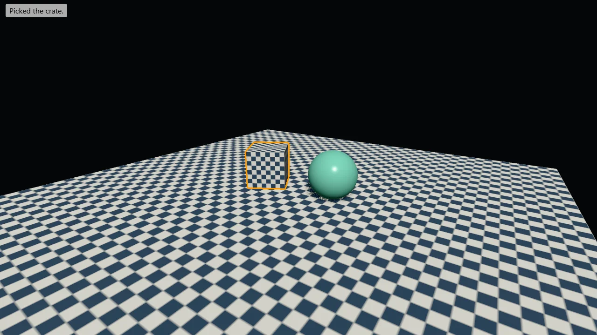
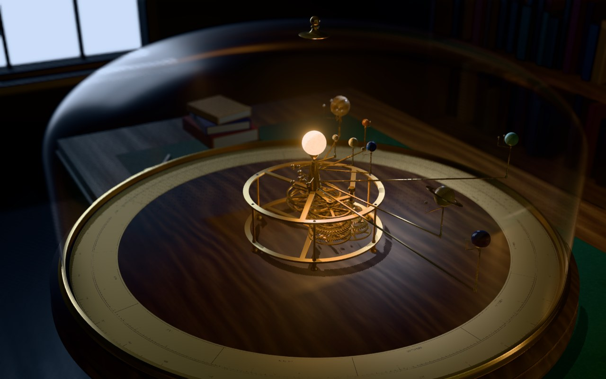
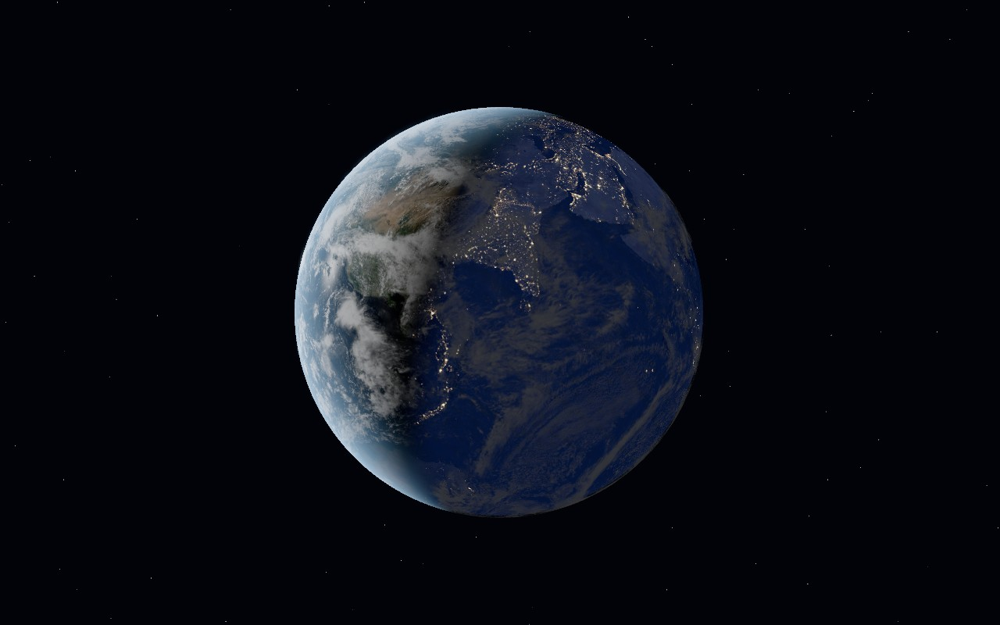

# Margo Engine

A small WebGPU engine for the web, with a Rust/Wasm core.

[](https://github.com/scottcampbelldata/margoengine/actions/workflows/ci.yml)
[](LICENSE)



**[Build something in 5 minutes: a textured, lit scene with shadows and picking](#build-something-in-5-minutes)** ·
[Start here: guides by goal](docs/start-here.md) · [Demos](#demos) ·
[Coming from three.js](docs/from-threejs.md) ·
[Coming from Babylon.js](docs/from-babylon.md)

The core and the stage together are 24,846 bytes gzip, Wasm kernel and WebGPU backend included. Everything else
(glTF, shadows, physics, post effects) is a separate package you import only if you use it.

## Build something in 5 minutes

You need git and Node.js 24.18 or newer, nothing else: no Rust, C++ compiler, Python or GPU setup (the Wasm kernel is
checked in). Node 22.12 or newer also builds the packages and runs the examples (npm prints one engine warning), but
the tests need 24.18. The packages are not on npm yet, so you start from a clone.

```sh
GIT_LFS_SKIP_SMUDGE=1 git clone --depth 1 https://github.com/scottcampbelldata/margoengine.git
cd margoengine
npm ci
npm run build:packages
npm run dev:examples
```

In PowerShell:

```powershell
$env:GIT_LFS_SKIP_SMUDGE=1
git clone --depth 1 https://github.com/scottcampbelldata/margoengine.git
cd margoengine
npm ci
npm run build:packages
npm run dev:examples
```

`GIT_LFS_SKIP_SMUDGE=1` skips about 270 MB of test assets if you have Git LFS. If PowerShell refuses to run `npm.ps1`,
type `npm.cmd` instead of `npm`.

1. Open <http://127.0.0.1:5173/>. It goes to the quickstart page: a textured floor, a crate and a ball with soft
   shadows. Drag to orbit, scroll to zoom, click the crate.
2. Open `examples/quickstart/main.ts` in your editor, change the ball's colour `'#84d6bd'` to `'#e0402a'` and save. The
   page reloads with a red ball. Nothing to rebuild.
3. No WebGPU in your browser? The page loads the WebGL2 layer and draws the same scene.

Measured on a Windows 11 mini PC (Radeon 680M): clone 27 s, `npm ci` 40 s with an empty npm cache,
`npm run build:packages` 72 to 98 s, server ready in 5 s. Under 3 minutes from the first command to the page.

Next: [Quickstart](#quickstart) explains every line of that page, [Start here](docs/start-here.md) lists a guide for
each goal, and Route 2 under [Install](#install) puts the packages in a project of your own.

## Quickstart

You will build a floor, a crate and a ball with a texture, sun light, soft shadows, orbit controls and click-to-select.
It takes four steps in a new folder (or skip them and edit the page from [Build something in 5 minutes](#build-something-in-5-minutes)).

1. Install the packages as in Route 2 under [Install](#install) below (or use the clone from
   [Build something in 5 minutes](#build-something-in-5-minutes) and skip to step 4).
2. Save this as `index.html`:

```html index.html
<!doctype html>
<html lang="en">
  <head>
    <meta charset="utf-8" />
    <meta name="viewport" content="width=device-width, initial-scale=1" />
    <link rel="icon" href="data:," />
    <title>Margo Engine quickstart</title>
    <style>
      body { margin: 0; font: 16px system-ui, sans-serif }
      #scene { height: 100vh }
      #status { position: fixed; top: 8px; left: 12px; margin: 0; padding: 4px 8px; background: #fffa; border-radius: 4px }
    </style>
  </head>
  <body>
    <div id="scene"></div>
    <p id="status">Drag to orbit, scroll to zoom.</p>
    <script type="module" src="./main.ts"></script>
  </body>
</html>
```

3. Save this as `main.ts`:

```ts main.ts
import { createStage } from 'margoengine';
import { boxGeometry, planeGeometry, sphereGeometry } from 'margoengine/geometry';
import { PbrMaterial, Texture, createMesh } from 'margoengine/materials';
import { Picking, Selection } from 'margoengine/selection';
import { Shadows } from 'margoengine/shadows';

const status = document.querySelector('#status')!;
const fail = (error: Error): never => {
  status.textContent = `Margo could not start: ${error.message}. See "Browser support" in the README.`;
  throw error;
};

// No WebGPU here (an older browser, or one that blocks it)? Load the WebGL2 layer first: it runs this same scene, and
// a browser with WebGPU never downloads it.
const webgpu = 'gpu' in navigator && (await navigator.gpu.requestAdapter()) !== null;
if (!webgpu) await (await import('margoengine/webgl2-compat')).install().catch(fail);

// A 64 x 64 checkerboard painted in code, so the example needs no image file.
const pixels = new Uint8Array(64 * 64 * 4);
for (let y = 0; y < 64; y++)
  for (let x = 0; x < 64; x++) {
    const light = ((x >> 3) + (y >> 3)) % 2 === 0;
    pixels.set(light ? [235, 235, 225, 255] : [70, 90, 110, 255], (y * 64 + x) * 4);
  }
const checker = new Texture({ data: pixels, width: 64, height: 64 }, { wrapS: 'repeat', wrapT: 'repeat' });

// The stage mounts a canvas in #scene, adds orbit/pan/zoom with the mouse and starts the render loop.
const stage = await createStage('#scene', { camera: { position: [4, 3, 6], target: [0, 0.6, 0] } }).catch(fail);
const engine = stage.engine;

// Aim the sun from the left and above, so the shadows fall to the right, where the camera can see them.
engine.scene.lighting.direction.set([-4, 4, 2, 3]); // x, y, z point toward the light; the last number is its strength

// Three lit, textured meshes.
const floor = new PbrMaterial({ map: checker });
floor.setUVTransform({ scale: [6, 6] }); // repeat the texture 6 times across the floor
const ground = createMesh(engine, planeGeometry(12, 12), floor);
ground.root.setRotation([-Math.PI / 2, 0, 0]); // planes face +z; lay it flat
const crate = createMesh(engine, boxGeometry(1, 1, 1), new PbrMaterial({ map: checker, roughness: 0.6 }));
crate.root.setPosition([-1, 0.5, 0]);
const ball = createMesh(engine, sphereGeometry(0.6, 48, 24), new PbrMaterial({ color: '#84d6bd', roughness: 0.25 }));
ball.root.setPosition([1, 0.6, 0]);

// Shadows: tell the shadow package which meshes cast and receive.
const shadows = Shadows.attach(engine, { resolution: 2048 });
for (const mesh of [ground, crate, ball]) shadows.add(mesh);

// Click a mesh to outline it; click empty space to clear.
const picking = Picking.attach(engine);
const outline = Selection.attach(engine, { color: [1, 0.6, 0] });
const names = new Map<unknown, string>([
  [crate, 'crate'],
  [ball, 'ball'],
]);
let pressed = [0, 0];
let busy = false; // one pick can wait at a time
engine.canvas.addEventListener('pointerdown', (event) => {
  pressed = [event.clientX, event.clientY];
});
engine.canvas.addEventListener('click', async (event) => {
  const moved = Math.hypot(event.clientX - pressed[0], event.clientY - pressed[1]);
  if (busy || moved > 4) return; // ignore the end of an orbit drag
  busy = true;
  const hit = await picking.pick(event.offsetX, event.offsetY);
  busy = false;
  const name = hit?.model ? names.get(hit.model) : undefined;
  outline.set(name && hit ? [hit.mesh] : []);
  status.textContent = name ? `Picked the ${name}.` : 'Click the crate or the ball.';
});

stage.onTick((delta) => {
  crate.root.rotation.y += delta * 0.5;
});
window.addEventListener('pagehide', () => stage.dispose(), { once: true });
```

4. Run `npx vite` and open the address it prints. Drag to orbit, scroll to zoom, right-drag to pan, click the crate.

If the page is blank or shows an error:

- Vite says `Failed to resolve import "margoengine"`: step 1 did not run in this folder. Run the `npm install` line from
  Route 2 again in the folder that holds `index.html` (and use `npx vite` there, not in the clone).
- The status line says `Margo could not start`: the browser has neither WebGPU nor the WebGL2 features the layer
  needs (it names what is missing). Use desktop Chrome, Edge or Firefox, or see [Browser support](#browser-support).

The scene is about 60 lines. Three things to know about it:

- `createStage` mounts the canvas in `#scene`, adds mouse and touch camera controls and starts the render loop.
- `createMesh` (from `margoengine/materials`) draws a geometry with a `PbrMaterial`. That is how a mesh gets a
  texture. `stage.box()` and `stage.sphere()` make plain-colour meshes with no texture.
- Shadows, picking and outlines are separate packages. You import them when you want them and pay nothing when you do not.

To change it: the ball's size is the first number of `sphereGeometry` (its radius), so lift it by the same amount in
`setPosition`. A new mesh, such as a second crate, casts a shadow once you pass it to `shadows.add`, and the click handler
names it once you add it to `names`.

**WebGPU and the fallback.** Where the browser has no WebGPU, or blocks it (some school and office PCs, headless
Firefox), the first lines of `main.ts` load the [`@margoengine/webgl2-compat`](packages/webgl2-compat/README.md) layer,
and the same scene runs on WebGL2 with its textures, shadows and picking. It is a dynamic `import()`, so a browser with
WebGPU never downloads it and `createStage` stays the same size. Use the same two lines before `createStage` in your own
pages. The small [`@margoengine/webgl2-compat/preview`](packages/webgl2-compat/README.md) preview renders plain meshes
with flat shading only, so it cannot run this quickstart. Details are under [Browser support](#browser-support).

Next: [Start here](docs/start-here.md) lists a guide for each goal: [textures and materials](docs/guides/textures-and-materials.md),
[lights and shadows](docs/guides/lights-and-shadows.md), [camera and controls](docs/guides/camera-and-controls.md),
[interaction](docs/guides/interaction.md), [loading glTF](docs/guides/loading-gltf.md) and
[animation](docs/guides/animation.md).

## Install

Margo needs WebGPU (see [Browser support](#browser-support)). End users: Node 22.12 or newer (tested on 22.12 and the
latest 22.x, 24.18 and 26). Contributors: Node 24.18 or newer.

**The packages are not on npm yet.** `npm install margoengine` gets only a name placeholder (0.0.1, no engine) today;
1.0.0 is the first planned release.
Two routes work now. Both start from a clone. The quickstart does not need the [Git LFS](https://git-lfs.com) test
assets (about 270 MB), so skip them: if Git LFS is installed, set `GIT_LFS_SKIP_SMUDGE=1` for the clone (in PowerShell,
`$env:GIT_LFS_SKIP_SMUDGE=1`). You need the assets only to run the tests, see [Build from source](#build-from-source).

```sh
GIT_LFS_SKIP_SMUDGE=1 git clone --depth 1 https://github.com/scottcampbelldata/margoengine.git
cd margoengine
npm ci
```

**Route 1: run the quickstart inside the clone.** Nothing to install in a project of your own.

```sh
npm run build:packages
npm run dev:examples
```

Open <http://127.0.0.1:5173/examples/quickstart/>. That page is the quickstart above, saved as
[examples/quickstart/](examples/quickstart).

**Route 2: use the packages in your own project from local tarballs.** `npm run pack:packages` builds every package and
writes one `.tgz` file each to `test-results/`. Install them all, plus Vite, in a new folder. In Git Bash, macOS or
Linux:

```sh
npm run pack:packages
mkdir ../my-scene && cd ../my-scene
npm init -y
npm install ../margoengine/test-results/*.tgz vite
```

In PowerShell on Windows, which does not expand `*.tgz` for npm and (in version 5.1, the one Windows ships) does not
accept `&&`:

```powershell
npm run pack:packages
mkdir ../my-scene; cd ../my-scene
npm init -y
npm install (Get-ChildItem ../margoengine/test-results/*.tgz).FullName vite
```

If PowerShell says `npm.ps1 cannot be loaded because running scripts is disabled on this system`, type `npm.cmd` instead
of `npm` and `npx.cmd` instead of `npx`; they run the same programs.

On the machine used to write this page, `npm ci` took 15 seconds, packing 35 and the install 8; from the first command
to a rendered, verified page took 76 seconds (`npm run check:quickstart` repeats the whole run and fails above 300).
Then follow the Quickstart steps 2 to 4 above in `my-scene`.

**For a class or a tester with no clone:** `node scripts/pack-student-kit.mjs` writes `test-results/margo-student-kit.zip`:
one folder, `margo-student-kit`, holding every package packed (`margo-packages/*.tgz`), the two models the beginner and
game guides use (`examples/assets/`, both CC0, named in its `NOTICE.md`), this README and those guides. Unzipped next to
`my-scene`, it replaces `../margoengine/test-results/` in the install lines above with
`../margo-student-kit/margo-packages/`.

**After 1.0.0 is published,** `npm install margoengine vite` in a new folder replaces Route 2 and nothing else changes.

## Demos

[](examples/orrery/README.md)

[Orrery](examples/orrery/README.md): real planet positions for any date you pick, within arcminutes, checked against
JPL Horizons. Brass, walnut and glass under a dome, built with Margo Engine and Blender only.

[](examples/storm-light/README.md)

[Storm Light](examples/storm-light/README.md): a lighthouse in a night storm, its beam sweeping through volumetric fog
and rain over the ocean, with lightning. Built with Margo Engine and Blender only.

| | | |
| --- | --- | --- |
|  |  |  |
| [glTF PBR](examples/flight-helmet.html) | [Gameplay sandbox](examples/gameplay-sandbox/README.md) | [Earth](packages/creative/examples/earth/index.html) |

More in [examples/README.md](examples/README.md): character animation, a windy meadow, weather, a climbing robot,
science views and feature pages.

## Build from source

You need Node.js 24.18+ (the repository's tests need it; the packages you build run on Node 22.12+) and
[Git LFS](https://git-lfs.com) for the test assets.

```sh
git clone --depth 1 https://github.com/scottcampbelldata/margoengine.git
cd margoengine
git lfs install
git lfs pull
npm ci
npm test
```

`npm test` builds every package from the checked-in Wasm and runs the unit tests. You don't need Rust unless you
change the kernel.

```sh
npm run dev               # the Orrery demo (after npm run build:packages)
npm run dev:examples      # every page in examples/, e.g. /examples/flight-helmet.html
npm run lint              # Biome
npm run typecheck         # strict TypeScript for all packages
npm run test:all          # every Node test in the repo
npm run test:kernel       # Rust kernel tests (toolchain pinned in rust-toolchain.toml)
npm run measure:size      # core + stage size check
```

## Features

- WebGPU renderer with PBR, image-based lighting, cascaded shadows, clustered lights, SSAO, bloom, TAA and depth of
  field. Each one is its own package.
- Rust/Wasm transform kernel with GPU culling and instancing.
- Loaders for glTF/GLB (Draco, Meshopt, KTX2), FBX, USDZ, OBJ, STL, PLY, 3MF, COLLADA, IFC and more.
- Camera controls with CAD-style mouse presets, a view cube, GPU picking and selection outlines.
- Skinning, morph targets, blend trees and IK.
- Physics on Rapier, navmesh, ECS, input and audio.
- Terrain, water, sky, procedural scenery, voxels and a progressive voxel path tracer.
- React 18 and 19 components (`@margoengine/react`).
- Optional WebGL2 fallback: the compatibility layer runs the site's demos, the small preview draws basic scenes.

More examples are in [examples/](examples/README.md).

## Browser support

Margo Engine needs WebGPU. Without it, the optional `@margoengine/webgl2-compat` layer runs the WebGPU code of core and
the packages on WebGL2. Every site demo loads it; [docs/webgl2-compat-demos.md](docs/webgl2-compat-demos.md) lists how
each one compares with native WebGPU. The smaller `@margoengine/webgl2-compat/preview` fallback draws plain meshes only
(no textures or effects; picking is its optional `/pick` entry).

| Browser | Status |
| --- | --- |
| Chrome and Edge (desktop) | Tested. The automated browser suites run in Chromium on real GPUs: an NVIDIA RTX A6000 and an Intel Arc 140V on Windows 11, and an AMD Radeon 680M that ran every package GPU suite on WebGPU and on the WebGL2 layer. Every package's tests also ran on an Apple M6 Mac mini (Metal) in Chrome and Playwright WebKit, with the findings in [docs/known-bugs.md](docs/known-bugs.md). |
| Firefox | Partly tested. Playwright Firefox 157 on Windows runs the core, stage and WebGL2 layer GPU suites, on WebGPU and on the layer. Open Firefox bugs are in [docs/known-bugs.md](docs/known-bugs.md). |
| Safari on macOS | Checked by hand: Safari 27.2 on an Apple M6 draws five real models as Edge does. No suite runs in Safari itself. |
| Safari on iPhone | Demos run, checked by hand only. |
| Android | Not tested. |

[docs/limits.md](docs/limits.md) lists the hardware these results come from and what has not been checked.

## Size

| Bundle | gzip | raw |
| --- | --- | --- |
| core + stage (`import { createStage } from 'margoengine'`) | 24,846 B | 61,081 B |

Recorded in [entry-sizes.json](examples/package-benchmarks/results/entry-sizes.json), along with
the size of every other package entry. `npm run measure:size` bundles the entry with Vite, minified the same way as
the package build, gzips it at the default level and prints the figure for your checkout. The build fails if
core + stage reaches 25,000 B gzip.

`npm run bench` runs every benchmark suite (size, startup, rendering, loading, physics, memory and more;
`npm run bench -- --list` names them) and reports medians, p95 and machine checks. See
[docs/benchmarking.md](docs/benchmarking.md). Sizes of other engines, measured the same way, are in
[docs/whitepaper/claims.md](docs/whitepaper/claims.md#smallest-core-measured-2026-11-10). No speed comparison with
other engines is claimed.

## Architecture

```
your app
  margoengine            createStage: canvas, camera, controls, loading
  @margoengine/core      Engine, Scene, Mesh, Geometry, PbrMaterial; WebGPU renderer
    kernel (Rust/Wasm)   transforms, bounds and culling in one flat buffer
  @margoengine/*         optional packages, attached through core's extension hooks
```

Core is frozen: packages add render passes, materials and loaders through `@margoengine/core/extension` instead of
changing the base, so the base stays small and an app only pays for what it imports. The Rust source is in
`packages/kernel`; the compiled Wasm is checked in, so building the JavaScript never needs Rust.

[MODERN-ENGINE.md](MODERN-ENGINE.md) covers the architecture, lifecycle rules and limits in detail.
[docs/api-overview.md](docs/api-overview.md) is a short tour of the API. AI coding tools can read
[site/llms.txt](site/llms.txt) (an index) or [site/llms-full.txt](site/llms-full.txt) (all the docs in one file), or run
the `@margoengine/mcp` server ([docs/ai-tools.md](docs/ai-tools.md)).

## Packages

<!-- package-list: generated from docs/catalog.json by scripts/build-catalog.js; do not edit -->

108 packages in 12 layers, the same layers as the searchable catalog that `npm run catalog` serves.

### Start here (7)

| Package | What it is |
| --- | --- |
| [`@margoengine/stage`](packages/stage/README.md) | The stage: createStage mounts a canvas, camera controls and rendering in five lines. Re-exported by margoengine. |
| [`@margoengine/core`](packages/core/README.md) | WebGPU rendering and a Wasm transform kernel. WebGL2 is the optional @margoengine/webgl2-compat package. |
| [`@margoengine/game`](packages/game/README.md) | Install profile. Games: models, animation, light and shadow, sky, physics, audio, input, effects |
| [`@margoengine/kit-web`](packages/kit-web/README.md) | Install profile. Product viewers and 3D on web pages: a glTF model, studio light, orbit, HTML on top |
| [`@margoengine/kit-viz`](packages/kit-viz/README.md) | Install profile. Data and scientific visualization: figures and GPU compute, points, lines, splats, terrain, labels and text |
| [`@margoengine/kit-react`](packages/kit-react/README.md) | Install profile. React and Next.js web apps |
| [`margoengine`](packages/margoengine/README.md) | Margo Engine in one install: the stage and every package as margoengine/<name> (margoengine/gltf, margoengine/shadows, margoengine/physics, margoengine/react). |

### Setup and diagnostics (6)

| Package | What it is |
| --- | --- |
| [`@margoengine/math`](packages/math/README.md) | Vector, quaternion, matrix, Euler, color, bounds, ray, plane and frustum math, one module per type. |
| [`@margoengine/quality`](packages/quality/README.md) | Measured quality tiers: start light, time the GPU, remember full 4x quality only where it has headroom. |
| [`@margoengine/webgl2-compat`](packages/webgl2-compat/README.md) | WebGL2 compatibility for browsers without WebGPU: install() runs the real renderer with a WebGPU-shaped device, WGSL translation and tiered compute. Optional /preview, /pick, /restore and /auto entries preserve the smaller preview on lower-tier WebGL2; /xr supports WebXR. |
| [`@margoengine/worker`](packages/worker/README.md) | Runs Margo Engine in a Web Worker on an OffscreenCanvas: canvas transfer, resize, pixel ratio and input forwarding, so heavy scenes never block the page. |
| [`@margoengine/stats`](packages/stats/README.md) | Allocation-free frame samples, DOM performance overlay, optional WebGPU timestamp profiling, pipeline compile tracking, a CPU phase breakdown, leak alerts and field telemetry. |
| [`@margoengine/inspector`](packages/inspector/README.md) | Entity hierarchy, live properties, WebGPU wireframe, normal and bounding-box overlays, and a frame debugger. |

### Loading and formats (13)

| Package | What it is |
| --- | --- |
| [`@margoengine/gltf`](packages/gltf/README.md) | glTF 2.0 for Margo Engine: a light static loader at the root, metallic-roughness PBR rendering at @margoengine/gltf/pbr. |
| [`@margoengine/loaders`](packages/loaders/README.md) | PLY, STL, 3MF, PCD, OFF, XYZ, OBJ/MTL, COLLADA, Tiled TMX, VTK, NRRD, LDraw, Rhino 3DM, 3DS, LWO, AMF, MD2, PDB, KMZ, NURBS, LAS, OpenVDB, MaterialX, Lottie, static USDA/USDZ, SVG and TrueType font loaders for Margo Engine. |
| [`@margoengine/decoders`](packages/decoders/README.md) | Worker-pooled Draco geometry and KTX2/Basis texture decoding, and synchronous PNG, TGA, TIFF, DDS and KTX reading, for Margo Engine. |
| [`@margoengine/fbx`](packages/fbx/README.md) | Binary and ASCII FBX conversion into the optional Margo glTF animation pipeline. |
| [`@margoengine/usdz`](packages/usdz/README.md) | Optional static USDA, USDC and USDZ ingestion through Margo glTF PBR. |
| [`@margoengine/exporters`](packages/exporters/README.md) | glTF/GLB, STL, OBJ, PLY, USDZ, COLLADA and 3MF exporters for Margo Engine scenes and geometry data. |
| [`@margoengine/cad`](packages/cad/README.md) | CAD import for Margo Engine: STL and OBJ parsing with welding and part deduplication, STEP, IGES, ACIS SAT, Parasolid XT and JT through Margo's own B-rep kernel in a worker, and the stage addCAD helper. |
| [`@margoengine/brep`](packages/brep/README.md) | Margo's own CAD kernel: STEP (ISO 10303-21), IGES 5.3, ACIS SAT, Parasolid XT and JT (ISO 14306) reading, product structure, units and colours, exact B-rep geometry (analytic surfaces and NURBS) and crack-free tessellation. |
| [`@margoengine/ifc`](packages/ifc/README.md) | IFC geometry and BIM identifiers for Margo Engine, using an initialized web-ifc runtime. |
| [`@margoengine/blender`](packages/blender/README.md) | Optional offline Blender .margo assets using Margo's WebGPU PBR renderer. |
| [`@margoengine/cache`](packages/cache/README.md) | Opt-in offline asset cache: a fetch-compatible IndexedDB cache for GLB, .bin and texture files with ETag/Last-Modified revalidation, app versioning, range requests, a byte budget with LRU eviction and network fallback. |
| [`@margoengine/splats`](packages/splats/README.md) | Optional Gaussian splats with GPU covariance projection and stable compute radix sorting. |
| [`@margoengine/tiles`](packages/tiles/README.md) | Streaming OGC 3D Tiles 1.1: implicit and explicit tilesets, screen-space-error selection, a fetch queue, a memory budget and glTF tiles drawn through gltf/pbr. |

### Rendering and lighting (24)

| Package | What it is |
| --- | --- |
| [`@margoengine/materials`](packages/materials/README.md) | Optional glTF PBR material lobes, transmission, volume, parallax occlusion, triplanar and subsurface scattering, and typed node graphs through an isolated extension slot. |
| [`@margoengine/shader`](packages/shader/README.md) | Typed shader nodes that compile to readable WGSL: node materials, node post effects and node compute passes, with a visual node editor. |
| [`@margoengine/environment`](packages/environment/README.md) | HDR/EXR/UltraHDR loading, EXR writing, image-based lighting (prefiltered specular, SH irradiance, BRDF LUT), environment backgrounds and scene fog for Margo Engine on WebGPU. |
| [`@margoengine/clustered`](packages/clustered/README.md) | WebGPU clustered forward point and spot lighting with optional local shadows. |
| [`@margoengine/shadows`](packages/shadows/README.md) | Four-cascade cached directional shadows with PCSS. |
| [`@margoengine/lightmap`](packages/lightmap/README.md) | CPU lightmap atlases with native albedo, emission, normal and ORM textures; triangle meshes at their own UV1 (./mesh), also progressively on the GPU (./gpu), with directional lightmaps (./directional) and irradiance probes from the same scene (./probes); optional area lights, emissive surfaces, bounces and glass (./global), caustics through rough and dispersive glass with bounces (./refracted) and an edge-avoiding a-trous denoiser (./denoise). |
| [`@margoengine/sky`](packages/sky/README.md) | Procedural atmospheric skies, clouds, sun, moon, stars and weather (rain, snow, lightning), with a moonlit night sky, day presets, preset scenes, scene kits, the Milky Way, aurora and a textured moon. |
| [`@margoengine/weather`](packages/weather/README.md) | Weather over time: a state machine with presets that blends rain, snow, hail, wind and lightning; a deterministic wind field; wet and snowy surface hooks in JavaScript and WGSL; snow avalanches with a powder cloud that run out, entrain the cover, break trees and settle; volcanic eruption columns with an umbrella cloud, ash fall and plume lightning; lava flows that run down the ground and crust over with glowing cracks, fountains, bombs and glow lights; snow that drifts, builds cornices, sloughs and carries a slab's slide state; helpers for the sky's Weather; and bouncing GPU hail. |
| [`@margoengine/toon`](packages/toon/README.md) | Stepped diffuse shading and inverted-hull outlines. |
| [`@margoengine/oit`](packages/oit/README.md) | Order-independent transparency for gltf/pbr BLEND primitives and materials transparent meshes: weighted blending, moment-based blending, or exact per-pixel layer lists, with no popping between overlapping transparent parts. |
| [`@margoengine/lod`](packages/lod/README.md) | Level of detail with hysteresis and screen-size switching for thousands of instances, plus GPU-baked octahedral imposters drawn in one instanced call per atlas. |
| [`@margoengine/culling`](packages/culling/README.md) | GPU-driven static instances: frustum and Hi-Z occlusion culling in compute, order-preserving compaction and indirect draws, no per-part CPU work per frame. |
| [`@margoengine/points`](packages/points/README.md) | Large point clouds (PointCloud, PointsMaterial) and instanced sprites (SpriteBatch, SpriteMaterial) for Margo Engine, WebGPU. |
| [`@margoengine/sprites`](packages/sprites/README.md) | 2D sprites at exact pixels: one instanced draw per layer, atlas rectangles, pivot, flip, rotation, tint, z and y sorting, integer pixel snapping and an optional normal map target, camera-facing billboards in 3D and bone-driven 2D skeletal meshes. |
| [`@margoengine/lines`](packages/lines/README.md) | Fat lines (Line, LineMaterial) and debug helpers for Margo Engine, WebGPU. |
| [`@margoengine/text`](packages/text/README.md) | GPU signed distance field text for Margo Engine: runtime glyph atlases from any browser font, wrapping, alignment, outlines and shadows, WebGPU. |
| [`@margoengine/pixel`](packages/pixel/README.md) | Pixel art rendering: a pixel camera with integer zoom and parallax, and a layer compositor that scales low-res layers by whole numbers and turns them with every output pixel one source pixel. |
| [`@margoengine/lighting2d`](packages/lighting2d/README.md) | 2D lights for Margo Engine: point, spot and directional lights with normal-mapped shading and hard shadows from occluder edges, for pixel layers. |
| [`@margoengine/labels`](packages/labels/README.md) | HTML labels and CSS 3D objects positioned over a Margo Engine canvas. |
| [`@margoengine/html`](packages/html/README.md) | World-space DOM anchors, CSS3D placement and scene-depth occlusion. |
| [`@margoengine/video`](packages/video/README.md) | WebGPU external video textures and optional Web Audio sampling. |
| [`@margoengine/xr`](packages/xr/README.md) | Optional WebGPU WebXR sessions, input poses and stereo rendering for Margo Engine, with real-device runs (./device-check). |
| [`@margoengine/headless`](packages/headless/README.md) | Render without a browser page: a stand-in canvas for core, GPU globals from the WebGPU binding you pass in, and readback to RGBA pixels or PNG bytes. |
| [`@margoengine/studio`](packages/studio/README.md) | Product-shot studio: soft ground contact shadows (shadow-catcher plane), accumulated and path-traced shots, caustics and a cyclorama backdrop for core meshes and glTF models. |

### Post-processing (5)

| Package | What it is |
| --- | --- |
| [`@margoengine/post`](packages/post/README.md) | HDR bloom, frame-graph SSAO, GTAO, SSGI and SSR, motion blur, lens flare, SMAA and FXAA, glitch and afterimage, and post-effect stacks for Margo Engine WebGPU. |
| [`@margoengine/tonemap`](packages/tonemap/README.md) | Optional color grading: Khronos PBR Neutral (the engine default), AgX and ACES fitted curves, 2-65 cube LUTs. |
| [`@margoengine/dof`](packages/dof/README.md) | Optional two-pass WebGPU depth of field with circular bokeh. |
| [`@margoengine/taa`](packages/taa/README.md) | Optional temporal anti-aliasing with motion vectors and YCoCg history clamping. |
| [`@margoengine/transitions`](packages/transitions/README.md) | WebGPU scene wipes, noise dissolves and chromatic displacement. |

### World and effects (15)

| Package | What it is |
| --- | --- |
| [`@margoengine/terrain`](packages/terrain/README.md) | Geometry clipmaps and triplanar terrain layers. |
| [`@margoengine/biomes`](packages/biomes/README.md) | Biome maps from a heightmap and a few climate settings: integer fixed-point climate fields, biome classification with smooth ecotones, presets, terrain ground weights and editor hooks, byte-identical on every platform. |
| [`@margoengine/voxel`](packages/voxel/README.md) | Voxel worlds: a block-type registry, 32-cubed palette chunks with light bytes, and a chunked world with dirty tracking and change events. |
| [`@margoengine/voxel-pathtracer`](packages/voxel-pathtracer/README.md) | Progressive WebGPU path tracer for instanced voxel models: diffuse, plastic, metal, glass, emissive, blended and volumetric materials, sun, sky, HDR environment and area lights, depth of field, motion blur, a denoiser and PNG capture. |
| [`@margoengine/voxel-edit`](packages/voxel-edit/README.md) | Editing voxel models for editors and tools: dense and sparse grids, modeling operations, brushes and selections, picking, export meshing, .vox scene editing and frame animation. |
| [`@margoengine/water`](packages/water/README.md) | Gerstner water surfaces, terrain-coupled shallow-water flow, foam and spray. |
| [`@margoengine/scatter`](packages/scatter/README.md) | Seeded instancing, distance-based LOD and procedural wind. |
| [`@margoengine/scenes`](packages/scenes/README.md) | Ready places built from the engine's packages in one call: a catalogue of scenes, each with documented settings, presets, anchors and camera views. |
| [`@margoengine/road`](packages/road/README.md) | Arc-length spline road surfaces, raised curbs and tiled UVs. |
| [`@margoengine/tilemap`](packages/tilemap/README.md) | 2D tile maps for Margo Engine: the TileMapData format (tilesets, animated tiles, collision shapes, tile and object layers, parallax), a chunked renderer at exact pixels, auto-tiling and the Tiled and LDtk importers. |
| [`@margoengine/vfx`](packages/vfx/README.md) | GPU particle simulation and indirect billboards, with curves over life and sphere, cone and mesh-surface emitters. |
| [`@margoengine/creative`](packages/creative/README.md) | WebGPU particles, atmosphere, toon shading and post-processing for Margo Engine. |
| [`@margoengine/procedural`](packages/procedural/README.md) | Procedural cabins, foliage, grass, humanoids, Marching Cubes surfaces, seeded 2D/3D/4D noise, L-systems, Voronoi fracture and a bounded voxel expression language. |
| [`@margoengine/wfc`](packages/wfc/README.md) | Seeded wave function collapse: 3D tile adjacency and the 2D overlapping (sample-based) model with backtracking. |
| [`@margoengine/splines`](packages/splines/README.md) | 3D Catmull-Rom, Bezier, Hermite, B-spline and Kochanek-Bartels curves with arc-length lookup, closest point, stable frames and knot editing. |

### Animation and interaction (19)

| Package | What it is |
| --- | --- |
| [`@margoengine/animation`](packages/animation/README.md) | Storage-buffer skinning and compute morph targets for Margo Engine. |
| [`@margoengine/animator`](packages/animator/README.md) | Blend trees, additive layers, animation states, foot IK, CCD IK chains, root motion, and look-at and aim constraints. |
| [`@margoengine/kinematics-constraints`](packages/kinematics-constraints/README.md) | Standalone analytical capsule, sphere and convex hull constraints for IK target and arm clearance. |
| [`@margoengine/robot-planning`](packages/robot-planning/README.md) | Robot arms on kinematics-constraints: a joint tree with collision shapes, swept motion checks, a joint-limit IK solver, sampling planners, URDF loading and a WebGPU clearance batch. |
| [`@margoengine/rigging`](packages/rigging/README.md) | Rigging and animation authoring: automatic skin weights, weight painting, skin checks, IK chains with poles, retarget presets, spring bones, VRM 1.0 avatars, geodesic voxel weights, corrective shapes, weight transfer, face tracking, automatic rigs from a bare mesh. |
| [`@margoengine/humans`](packages/humans/README.md) | People in one call: addPerson dresses a loaded character with skin, eyes and strand hair by material name, an Animator with clip cross-fades, dual quaternion skinning, shadows and natural hand poses; a period cast kit of measured bodies and code-built garments with measured cloth optics, fitted and skinned to any loaded rig in one call. |
| [`@margoengine/horses`](packages/horses/README.md) | Horses built in code from published equine measurements: draft, cavalry and riding builds, coats and markings, a mane and tail in strand hair, a 37-joint rig, walk, trot, canter and gallop from equine biomechanics, a rider seat, and crowds of hundreds in one draw. |
| [`@margoengine/armies`](packages/armies/README.md) | Armies of hundreds: soldiers and riders drawn at every distance (instanced skinning near, a vertex animation of a simplified mesh far, culled and budgeted), following navmesh formations, keeping step, riding horses on the saddle the horse crowd draws; any person source plugs in. |
| [`@margoengine/tween`](packages/tween/README.md) | Allocation-free numeric tween updates and easing timelines. |
| [`@margoengine/cinematic`](packages/cinematic/README.md) | Virtual cameras with priorities and blends, framing, dolly tracks, group framing, camera noise, confiners and focus tracking, on top of damped follow, look-at and shake. |
| [`@margoengine/cutscene`](packages/cutscene/README.md) | Cutscene timelines: camera, transform, property, animation, audio, subtitle and event tracks, nested timelines, scrubbing, a player that fires events in order, virtual camera shots with blends, rendering to a video file, a take recorder, dialogue with lip sync, and particle and activation tracks, and a timeline editor panel. |
| [`@margoengine/controls`](packages/controls/README.md) | Orbit, map, trackball, arcball, fly, first-person, pointer-lock and collision-aware walkthrough (/walk) camera controls, a transform gizmo and drag controls for Margo Engine. |
| [`@margoengine/cameras`](packages/cameras/README.md) | Orthographic projection and exactly vertical (top-down) views for the core camera, with matching culling and picking. |
| [`@margoengine/input`](packages/input/README.md) | Semantic keyboard, pointer, gamepad, touch, gyro and pen actions with haptics, tap, hold, slow tap and double press rules, local multiplayer, and recording and replay. |
| [`@margoengine/ui`](packages/ui/README.md) | Game UI drawn in the engine: menus, HUDs, health bars, inventories, dialogs and toasts with flex layout, theming, keyboard, gamepad and touch navigation, screen reader support and React components. |
| [`@margoengine/viewcube`](packages/viewcube/README.md) | CAD view cube: shows the camera orientation and animates to top, front, side and isometric views, with a perspective/orthographic toggle. |
| [`@margoengine/selection`](packages/selection/README.md) | GPU picking and visible mesh selection outlines. |
| [`@margoengine/audio`](packages/audio/README.md) | Web Audio listener, global and positional sounds and a frequency analyser for Margo Engine. |
| [`@margoengine/mixer`](packages/mixer/README.md) | Audio mixing and effects: buses with gain, mute, solo, sends and ducking; equaliser, filter, compressor, limiter, delay and reverb on Web Audio; positional emitters; deterministic offline rendering. |

### Simulation and games (10)

| Package | What it is |
| --- | --- |
| [`@margoengine/physics`](packages/physics/README.md) | Rigid-body physics for Margo Engine on its own Rust kernel: fixed-step engine plugin with interpolation, colliders, joints, queries, events, a character controller, vehicles and ropes. |
| [`@margoengine/physics2d`](packages/physics2d/README.md) | 2D rigid-body physics for Margo Engine on its own 2D kernel (Rust to Wasm): fixed-step plugin with interpolation, sprite-driven bodies, joints, queries, events, a character controller and tile map colliders. |
| [`@margoengine/ragdoll`](packages/ragdoll/README.md) | Ragdolls on Margo physics: capsule bodies from a skeleton, cone and hinge joint limits, kinematic hit boxes, going limp and blending back to the animation. |
| [`@margoengine/navmesh`](packages/navmesh/README.md) | Convex polygon navigation with A*, funnel paths and ORCA avoidance; navmesh generation from triangles (./build) tiled meshes that rebuild at run time (./tiles), baked files (./codec), jump links (./links), long routes (./hierarchy), debug draw (./debug), voxel worlds (./voxel) and flying agents (./volume). |
| [`@margoengine/ecs`](packages/ecs/README.md) | Typed-array packed sparse-set entity component storage. |
| [`@margoengine/fsm`](packages/fsm/README.md) | Hierarchical state machines with history, delayed transitions, parallel regions, JSON documents, snapshots and traces. |
| [`@margoengine/behavior`](packages/behavior/README.md) | Game AI: behaviour trees with a typed blackboard and async tasks, utility-AI scoring, steering and flocking behaviours, perception (./perception), environment queries (./eqs), a goal planner (./goap), smart objects (./smart-objects), flow fields (./flowfield), a task network planner (./htn), and context steering (./context). |
| [`@margoengine/save`](packages/save/README.md) | Save and load: versioned scene and world documents with stable ids, prefabs with overrides, migrations, all-or-nothing loading and storage adapters. |
| [`@margoengine/netcode`](packages/netcode/README.md) | Game networking for any game: schema-first binary codec with delta snapshots, an authoritative fixed-timestep server, client prediction and reconciliation, interpolation and a loopback network for tests. |
| [`@margoengine/voxel-net`](packages/voxel-net/README.md) | Multiplayer voxel worlds: an authoritative Node server on a hand-written WebSocket, a browser client with prediction and correction, and headless bots for load tests. |

### Geometry and spatial (5)

| Package | What it is |
| --- | --- |
| [`@margoengine/machinery`](packages/machinery/README.md) | Kinematics, sections, metrology, clearance, assemblies, exploded views, feature edges, dimensions, spatial queries, surface transport and telemetry for Margo Engine. |
| [`@margoengine/bvh`](packages/bvh/README.md) | Triangle BVH, spatial queries and an engine Raycaster for Margo Engine. |
| [`@margoengine/geometry`](packages/geometry/README.md) | Pure-CPU, tree-shakable geometry for Margo Engine: primitives, curves, shapes, extrusion, triangulation and mesh utilities. |
| [`@margoengine/mesh-edit`](packages/mesh-edit/README.md) | Pure polygon editing with retained corner UVs, explicit topology provenance and conservative cleanup. |
| [`@margoengine/scene`](packages/scene/README.md) | Scene graph conveniences for core meshes: children, traverse, userData, lookAt and world position, rotation and scale, as functions or as mesh members. |

### Data and science (2)

| Package | What it is |
| --- | --- |
| [`@margoengine/compute`](packages/compute/README.md) | GPU compute without the WebGPU boilerplate, NumPy style: N-d arrays with views and broadcasting, fused expressions, reductions and statistics, scan, sort, selection, histograms, matmul, FFT, convolution, random numbers, streaming, neural networks, graph algorithms, and WGSL kernels bound by name. |
| [`@margoengine/sciviz`](packages/sciviz/README.md) | Scientific visualisation for Margo Engine: volume rendering with transfer functions, slices and GPU isosurfaces, million-point scatter plots, surface and line plots with axes, ticks, labels and colour bars, and perceptual colour maps. |

### AI tools (1)

| Package | What it is |
| --- | --- |
| [`@margoengine/mcp`](packages/mcp/README.md) | A Model Context Protocol server for Margo Engine: AI coding tools (Claude, Cursor, Copilot) search the docs and API, read a package, list the examples and type-check a snippet against the real package types. Plain stdio JSON-RPC, no dependencies. |

### Frameworks (1)

| Package | What it is |
| --- | --- |
| [`@margoengine/react`](packages/react/README.md) | React 18/19 components and stable mesh refs for Margo Engine. |

<!-- /package-list -->

## Roadmap

- Publish 1.0.0 to npm.
- The WebGL2 compatibility layer is an optional package that WebGPU users never load ([docs/webgl2-compat-roadmap.md](docs/webgl2-compat-roadmap.md)); the voxel path tracer refuses it. `@margoengine/webgl2-compat/preview` is the small preview; in the React Canvas, `loadFallback` loads it and `fallbackContent` replaces the plain message.
- Automated runs in more places: Android, iPhone, macOS Safari, and more of the suites in Firefox and on Apple silicon.
- Published benchmark comparisons with their method and raw results.

## How the engine is built

AI agents write the code. Scott Campbell sets the rules in [AGENTS.md](AGENTS.md). A core change, or a change that removes or renames an export of a locked package, waits for his yes.

Every GPU check runs on our own machines, on real GPUs: NVIDIA RTX A6000, Intel Arc 140V, AMD Radeon 680M, and Apple silicon. Hosted runners have no GPU, so the workflows under `.github/workflows` are the CPU checks. The GPU checks run on those four machines.

The [Size](#size) section states the measured core and stage gzip. The build fails at 25,000 bytes (`scripts/core-budget.js`, through `npm run build:packages` and `npm run measure:size`).

A bug fix comes with a regression test that fails without the fix. A commit whose subject starts with `fix` changes a test file, or names the existing test in the message. A public claim goes in the same change, with its proof, in [docs/whitepaper/claims.md](docs/whitepaper/claims.md). `npm run api:check` fails when the reports in `api/` do not match the exports. Open bugs are written up with a repro and the cause in [docs/known-bugs.md](docs/known-bugs.md).

Runtime dependencies are an allowlist. [scripts/supply-chain.mjs](scripts/supply-chain.mjs) accepts only MIT, ISC, Apache-2.0, BSD-2-Clause, BSD-3-Clause, Zlib and 0BSD, and each one needs a written reason. `node scripts/supply-chain.mjs --check` fails when a new dependency has no reason.

The docs are run by tests. `npm run check:readmes` type-checks README examples, and `npm run check:readme-run` runs them. [site/llms.txt](site/llms.txt) and [site/llms-full.txt](site/llms-full.txt) are generated from the docs and package READMEs, and `tests/llms.test.js` fails when they are stale. [@margoengine/mcp](packages/mcp/README.md) serves that same material to AI tools: search the docs, read a package API report, and type-check a snippet against the real types.

## Contributing

Issues and pull requests are welcome. [CONTRIBUTING.md](CONTRIBUTING.md) covers setup, tests and what a good pull
request looks like. Please follow the [code of conduct](CODE_OF_CONDUCT.md), and report security issues as described
in [SECURITY.md](SECURITY.md).

## License

[Apache-2.0](LICENSE) (see also [NOTICE](NOTICE)). Third-party code and assets keep their own licenses; see
[THIRD-PARTY-NOTICES.md](THIRD-PARTY-NOTICES.md).

Made by Scott Campbell. [margoengine.com](https://margoengine.com)
