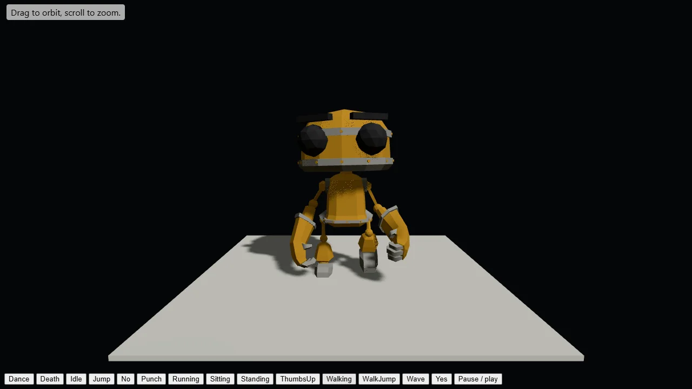

# Animation

You will load an animated character, play one of its clips, switch clips with buttons, and pause or scrub it. This
takes about five minutes.



A glTF file can carry animation clips: keyframes for bones (skinning), for node movement and for morph targets such as
facial expressions. `@margoengine/animation` plays them, and the GPU does the skinning.

## 1. Get a model with clips

This guide uses RobotExpressive (CC0, 0.5 MB, 14 clips). Copy `examples/assets/robot-expressive.glb` from this
repository to `public/models/` in your quickstart project. This page replaces `main.ts` in the
[quickstart](../../README.md#quickstart) project.

```ts
import { createStage } from 'margoengine';
import { Animation } from 'margoengine/animation';
import { loadGLTF } from 'margoengine/gltf-pro';
import { Shadows } from 'margoengine/shadows';

const stage = await createStage('#scene', { camera: { position: [0, 2, 6], target: [0, 1.2, 0] } });
const engine = stage.engine;
const robot = await loadGLTF(engine, '/models/robot-expressive.glb');
const b = robot.bounds; // frame the whole robot
engine.camera.fitToBoundingBox([b[0], b[1], b[2]], [b[3], b[4], b[5]]);
const floor = stage.box({ size: [8, 0.1, 8], position: [0, -0.05, 0], color: '#d4d4cc' });
const shadows = Shadows.attach(engine, { resolution: 2048 });
shadows.add(robot);
shadows.add(floor, { castShadow: false });
```

## 2. Attach the player and list the clips

`Animation.attach(model)` adds a player to the engine. Its fields start as `clip = 0` and `playing = true`.
`animation.clips` lists what the file holds.

```ts
const animation = Animation.attach(robot);
console.log(animation.clips.map((clip) => `${clip.name} (${clip.duration.toFixed(1)} s)`));
```

## 3. Play a clip

`play` takes a clip name or its index. It restarts the clip from time 0 and sets `playing` to `true`.

```ts
animation.play('Walking');
```

## 4. Switch clips with buttons

```ts
const bar = document.createElement('div');
bar.style.cssText = 'position:fixed;bottom:8px;left:8px;right:8px;display:flex;gap:4px;flex-wrap:wrap';
for (const clip of animation.clips) {
  const button = document.createElement('button');
  button.textContent = clip.name;
  button.onclick = () => animation.play(clip.name);
  bar.append(button);
}
document.body.append(bar);
```

## 5. Pause and scrub

`playing`, `time` and `clip` are plain fields. `time` is the number of seconds into the current clip and wraps at its
end while the clip loops. `seek(seconds)` jumps and poses the model at once, even while paused.

```ts
const pause = document.createElement('button');
pause.textContent = 'Pause / play';
pause.onclick = () => {
  animation.playing = !animation.playing;
};
bar.append(pause);
```

A slider scrubs the clip: dragging it pauses and seeks, and while the clip plays the slider follows it.

```ts
const scrub = document.createElement('input');
scrub.type = 'range';
scrub.min = '0';
scrub.step = 'any';
scrub.oninput = () => {
  animation.playing = false;
  animation.seek(Number(scrub.value));
};
stage.onTick(() => {
  scrub.max = String(animation.clips[animation.clip].duration);
  if (animation.playing) scrub.value = String(animation.time);
});
bar.append(scrub);
```

## Options you will use

Pass these as the second argument of `Animation.attach(model, { ... })`.

| Option | What it does | Default |
| --- | --- | --- |
| `loop` | Wrap at the end of the clip. `false` holds the last frame. | `true` |
| `speed` | Playback rate multiplier, 0 or more. | `1` |

`animation.setMorph(nodeIndex, targetIndex, weight)` sets a morph target by hand, for example a facial expression. For
blending between clips, additive layers, state machines and foot placement, use the
[animator](../../packages/animator/README.md) package. For a model made of raw arrays, see "Skeletons and skins from
raw data" in the [animation README](../../packages/animation/README.md).

## Common mistakes

- **The wrong clip plays first.** A new player uses the file's first clip. Call `play(name)` to choose another.
- **`play` throws "Unknown animation clip".** Clip names are case-sensitive. Print `animation.clips` and copy the name.
- **The animation freezes after you set `playing = false` and never resumes.** Set `playing = true`, or call `play`.
- **Many characters are slow.** Each `Animation` runs its own compute pass. For crowds, see
  [animator](../../packages/animator/README.md) and [instancing](../../packages/gltf-pro/README.md).
- **Animation needs WebGPU.** Skinning runs in a compute shader.

## Next

- Outline or click the character: [interaction](interaction.md).
- Move it with the keyboard: the [input](../../packages/input/README.md) package.
- Physics-driven characters: the [physics](../../packages/physics/README.md) package.
