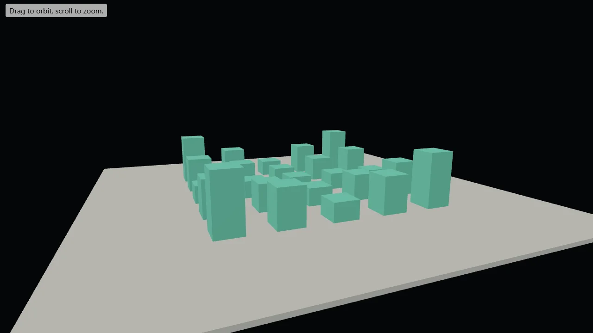

# Camera and controls

You will place the camera, let people orbit around a scene with the mouse and touch, and switch the mouse to the
layout of a modelling tool they know. This takes about five minutes.



The stage already gives you orbit, pan and zoom. This guide shows how to set the starting view, how to swap in the
fuller `OrbitControls` for more options, and where the other control schemes are.

## 1. Set the starting view

The camera has a `position`, a `target` it looks at, a vertical field of view `fov` in degrees (default 60) and the
`near` and `far` clip distances (defaults 0.1 and 1000). Pass any of them to `createStage`. Turn the stage's own
controls off with `controls: false` when you want to bring your own, as the next step does.

```ts
import { createStage } from 'margoengine';
import { OrbitControls } from 'margoengine/controls';

const stage = await createStage('#scene', {
  controls: false,
  camera: { position: [5, 4, 7], target: [0, 0.5, 0], fov: 50 },
});
const engine = stage.engine;
stage.box({ size: [12, 0.1, 12], position: [0, -0.05, 0], color: '#cfcfc8' });
for (let x = -2; x <= 2; x++)
  for (let z = -2; z <= 2; z++) {
    const height = 0.5 + Math.abs(x * z) * 0.25;
    stage.box({ size: [0.7, height, 0.7], position: [x * 1.4, height / 2, z * 1.4], color: '#84d6bd' });
  }
```

## 2. Orbit with the mouse and touch

`OrbitControls.attach(engine)` listens on the canvas and updates before every frame. Left drag turns the view, the
wheel zooms, right drag pans. One finger turns and two fingers zoom and pan.

```ts
const orbit = OrbitControls.attach(engine);
orbit.enableDamping = true; // glide to a stop (default false)
orbit.minDistance = 3; // closest the camera may get to the target (default 0)
orbit.maxDistance = 20; // farthest (default Infinity)
orbit.maxPolarAngle = Math.PI / 2 - 0.05; // stay above the floor (default PI, which allows going under it)
```

## 3. Zoom toward the pointer and limit panning

```ts
orbit.zoomToCursor = true; // the wheel zooms toward the point under the pointer (default false)
orbit.targetBounds = { min: [-6, 0, -6], max: [6, 3, 6] }; // panning cannot leave this box
```

## 4. Use the mouse layout of a modelling tool

A profile is a ready-made set of mouse buttons, wheel direction and shortcut keys. `BLENDER`, `SOLIDWORKS`, `AUTOCAD`,
`INVENTOR`, `FUSION`, `MAYA`, `ONSHAPE` and `RHINO` are exported. The default, `MARGO`, is what you have been using.
The layouts follow each tool's documented defaults; they have not been checked against running copies of the tools.

```ts
import { BLENDER } from 'margoengine/controls';

orbit.setProfile(BLENDER); // middle drag turns the view, Shift + middle pans
orbit.zoomToCursor = true; // set options after the profile; they win
```

## 5. Move or frame the camera from code

`engine.camera` is a plain object: change `position` and `target` and the next frame uses them. `fitToBoundingBox`
moves the camera back until a box fits in view.

```ts
engine.camera.fitToBoundingBox([-3, 0, -3], [3, 1.5, 3]);
```

## Other controls

| Class | Use it for |
| --- | --- |
| `OrbitControls` | Looking around an object or a room. |
| `MapControls` | Maps and top-down views: left drag pans along the ground. |
| `TrackballControls`, `ArcballControls` | Turning an object freely, with no fixed up direction. |
| `FlyControls`, `FirstPersonControls`, `PointerLockControls` | Free flight and first-person looking. |
| `WalkControls` (`margoengine/controls/walk`) | Walking through a building: eye height, stairs, slopes and walls. See [the walkthrough guide](walkthrough.md). |
| `TransformControls`, `DragControls` | Moving, turning and scaling objects. See [interaction](interaction.md). |

Every class has `enabled`, `update(delta)`, `dispose()` and `addEventListener`. Their full option lists are in the
[controls README](../../packages/controls/README.md).

## Common mistakes

- **Two controls fight over the mouse.** The stage adds its own controls unless you pass `controls: false`. Use one.
- **The camera goes under the floor.** Set `maxPolarAngle` just under `Math.PI / 2`.
- **The scene is cut off in the distance.** Raise `camera.far` (default 1000), and raise `near` as much as you can
  to keep depth precision.
- **Dragging a gizmo also turns the view.** Turn the orbit off while a gizmo drags:
  `gizmo.addEventListener('dragging-changed', (e) => { orbit.enabled = !e.value; })`.

## Next

- Click and select things: [interaction](interaction.md).
- Make the camera follow a character with damping and shake: the [cinematic](../../packages/cinematic/README.md) package.
- CAD view cube and orthographic views: [viewcube](../../packages/viewcube/README.md) and
  [cameras](../../packages/cameras/README.md).
