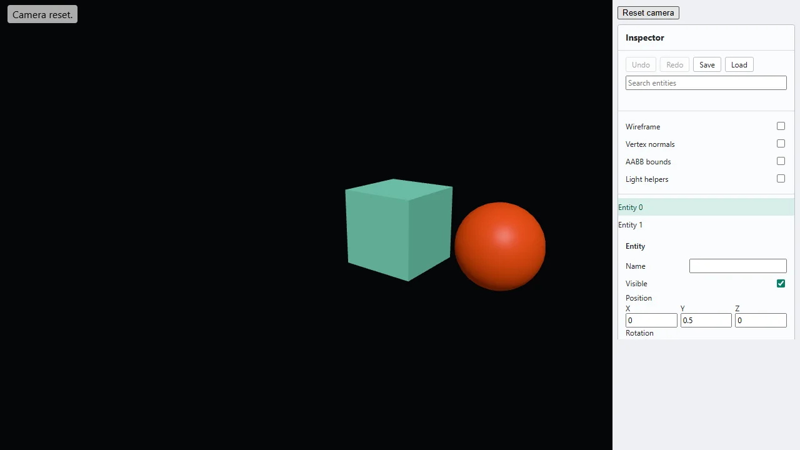

# Debugging a scene with the inspector

You will open Margo's inspector panel, put it in your page layout so it does not cover your own buttons, and use it to
see what the engine draws. This takes about five minutes.



The inspector is an optional DOM panel (`margoengine/inspector`). It shows the scene tree, lets you change names,
visibility, transforms and PBR values, counts what the engine draws, and shows the scene shader. It changes nothing
until you edit a field.

## 1. Set up a scene with a button of your own

This page replaces `main.ts` in the [quickstart](../../README.md#quickstart) project and needs its `index.html`. The
page gets its own layout: the canvas on the left, a sidebar on the right.

```ts
import { createStage } from 'margoengine';
import { Inspector } from 'margoengine/inspector';

const status = document.querySelector('#status')!;
const stage = await createStage('#scene', { camera: { position: [3, 2, 4], target: [0, 0.5, 0] } });
const engine = stage.engine;
const crate = stage.box({ size: [1, 1, 1], position: [0, 0.5, 0], color: '#84d6bd' });
stage.sphere({ radius: 0.5, position: [1.4, 0.5, 0], color: '#e45630' });

const sidebar = document.createElement('aside');
sidebar.style.cssText = 'position:fixed;top:0;right:0;bottom:0;width:300px;padding:8px;box-sizing:border-box;overflow:auto;background:#eef0f3';
const reset = document.createElement('button');
reset.textContent = 'Reset camera';
reset.onclick = () => {
  Object.assign(engine.camera, { position: [3, 2, 4], target: [0, 0.5, 0] });
  status.textContent = 'Camera reset.';
};
sidebar.append(reset);
document.body.append(sidebar);
```

## 2. Attach the inspector inside the sidebar

By default the inspector's element is `position: fixed` at the top right of the page, with a high `z-index`. That panel
sits on top of anything of yours in that corner and takes its clicks. Pass `parent` to put the element in your own
container, then override the position on the element itself. A style you set on `inspector.element` wins over the
panel's built-in style.

```ts
const inspector = Inspector.attach(engine, { parent: sidebar });
Object.assign(inspector.element.style, {
  position: 'relative', // in the flow of the sidebar, below the button
  top: 'auto',
  right: 'auto',
  width: '100%',
  maxHeight: '70vh', // a bounded size; the panel scrolls inside it
  overflow: 'auto',
  marginTop: '8px',
});
```

## 3. Select something and read what the engine draws

```ts
inspector.select(crate);
const resources = inspector.resources();
status.textContent = `${resources.meshes} meshes, ${resources.triangles} triangles. Selected: ${inspector.selected ? 'yes' : 'no'}.`;
window.addEventListener('pagehide', () => (inspector.dispose(), stage.dispose()), { once: true });
```

## What you should see

The canvas fills the page, and the sidebar on the right holds your button and then the inspector panel. The button and the
panel do not overlap. Click "Reset camera" and the status line says so.

## Common mistakes

- **The inspector covers your buttons.** You left it at its default `position: fixed`. Use `parent` and the position
  override above.
- **The panel is taller than the screen.** Set `maxHeight` on `inspector.element`.
- **Edits in the panel change every mesh that shares a material.** That is the engine's rule: one material, many meshes.
- **Debug overlays do nothing on the WebGL2 fallback.** Wireframe, normals, bounds and light helpers need WebGPU.

## Next

- Everything the panel can do: the [inspector README](../../packages/inspector/README.md).
- Time frames and count draws in your own scene: the [stats README](../../packages/stats/README.md).
