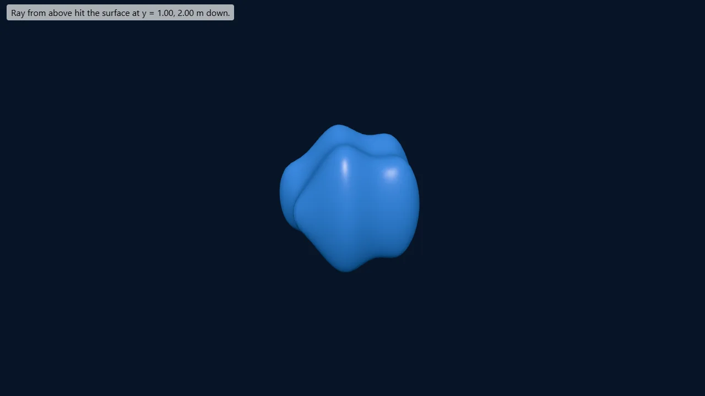

# Four calls people guess wrong

You will use four calls whose first guess is often wrong: a per-frame callback, a generated surface, a ray against a
mesh, and a post-processing stack. Each section shows the correct call, runs it, and says what the wrong guess was. This
takes about five minutes.



This page replaces `main.ts` in the [quickstart](../../README.md#quickstart) project. It needs WebGPU.

## 1. Set up the stage

```ts
import { createStage } from 'margoengine';
import { MeshBVH } from 'margoengine/bvh';
import { PbrMaterial } from 'margoengine/core';
import { Bloom } from 'margoengine/post/bloom';
import { PostStack } from 'margoengine/post/stack';
import { marchingCubes } from 'margoengine/procedural';
import { Tonemap } from 'margoengine/tonemap';

const status = document.querySelector('#status')!;
const stage = await createStage('#scene', { camera: { position: [3, 2, 4], target: [0, 0, 0] } });
const engine = stage.engine;
```

## 2. Frame callbacks get the engine and the seconds since the last frame

`engine.onFrame(callback)` calls `callback(engine, delta)` before every rendered frame. `delta` is a number of seconds
(about 0.016 at 60 frames per second). It is not a timestamp and not an object. Add the deltas to keep a clock. The call
returns a function that stops the callback.

```ts
let seconds = 0;
const stopClock = engine.onFrame((_engine, delta) => {
  seconds += delta;
});
```

`stage.onTick((delta) => ...)` is the same call with only the `delta` argument.

## 3. `marchingCubes` returns a geometry, or null

`marchingCubes(field, options)` samples `field(x, y, z)` on a grid inside `bounds` and returns the surface where the
field equals `level`. Negative values are inside. The result is a core `Geometry`, not a mesh: put it on a core mesh
with `engine.createMesh().setGeometry(geometry).setMaterial(material)`. (The `createMesh` of `margoengine/materials`
takes the other geometry shape from `margoengine/geometry`, so a `marchingCubes` result does not fit it.) The result is `null` when the surface does not touch the grid, so check for that.

```ts
const blob = marchingCubes((x, y, z) => Math.hypot(x, y, z) - 1 + 0.15 * Math.sin(5 * x) * Math.cos(5 * z), {
  resolution: [48, 48, 48],
  bounds: [
    [-1.6, -1.6, -1.6],
    [1.6, 1.6, 1.6],
  ],
});
if (!blob) throw new Error('The field never crosses level 0 inside the bounds.');
engine.createMesh().setGeometry(blob).setMaterial(new PbrMaterial({ color: '#4f8fe0', roughness: 0.35 }));
```

## 4. A ray is two plain arrays: `origin` and `direction`

`MeshBVH.fromGeometry(geometry)` builds the search tree once. `raycastFirst({ origin, direction })` returns the nearest
hit or `null`. The ray is in the geometry's own space (the mesh at the origin with no transform here, so the same as
world space), and `hit.distance` is how far along the ray the hit is, in the same units. The direction must be finite and not zero (a RangeError otherwise). The hit holds
`point`, `normal`, `faceIndex` and `distance`.

```ts
const bvh = MeshBVH.fromGeometry(blob);
const hit = bvh.raycastFirst({ origin: [0, 3, 0], direction: [0, -1, 0] });
status.textContent = hit
  ? `Ray from above hit the surface at y = ${hit.point[1].toFixed(2)}, ${hit.distance.toFixed(2)} m down.`
  : 'The ray missed.';
```

## 5. Attach a `PostStack` once, with all the effects in it

Each post effect alone owns the scene capture, so effects attached on their own reject each other (the [post README](../../packages/post/README.md#combining-effects-poststack) says so). `PostStack.attach(engine,
effects)` captures the scene once and runs the effects in array order. Do not call `attach` on the effects: the stack
does. Keep a reference to an effect to change its options later. Put `Tonemap` after effects that work in HDR. Disposing
the stack disposes its effects.

```ts
const bloom = new Bloom({ strength: 0.4 });
const stack = PostStack.attach(engine, [bloom, new Tonemap({ curve: 'neutral' })]);
bloom.strength = 0.6; // an option of the effect you kept
window.addEventListener('pagehide', () => (stopClock(), stage.dispose()), { once: true });
```

## Common mistakes

- **Using the first callback argument as the time.** It is the engine. The second argument is the delta in seconds.
- **Passing the result of `marchingCubes` to `setPosition` or the `createMesh` of `margoengine/materials`.** It is a core geometry. Give it to a core mesh with `setGeometry`.
- **Passing `{ origin: {x, y, z} }` to a ray.** Origin and direction are arrays (or typed arrays) of three numbers.
- **Attaching `Bloom` and `Tonemap` separately.** They reject each other. Put both in one `PostStack`.
- **Seeing a ray hit in the wrong place on a moved mesh.** The tree is in the geometry's space. Transform the ray by the
  inverse of the mesh's world matrix first, or keep the mesh at the origin.

## Next

- Which effects exist and what they cost: the [post package README](../../packages/post/README.md).
- Cast rays from the mouse and pick meshes: [interaction](interaction.md).
- The procedural noise, trees and terrain: the [procedural README](../../packages/procedural/README.md).
