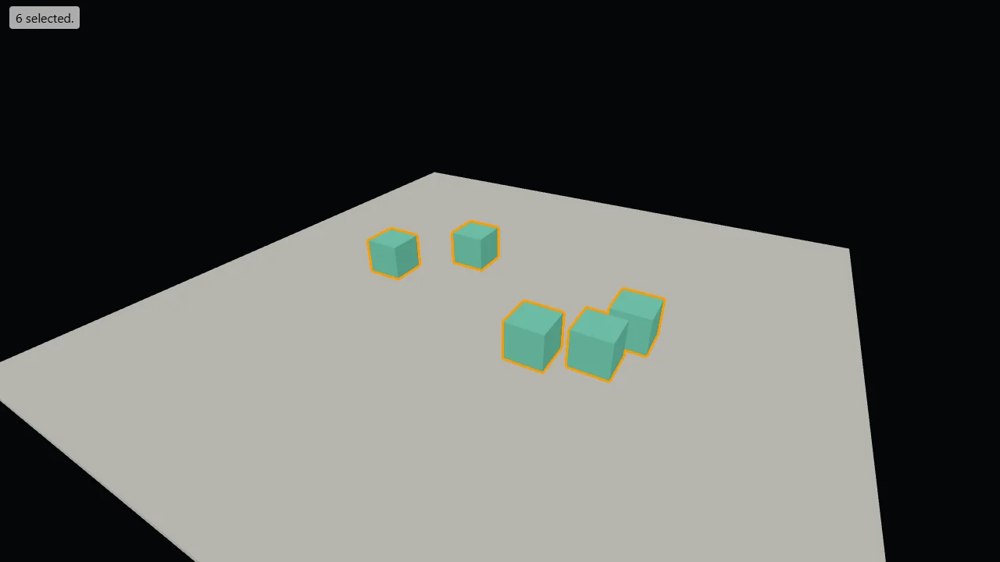

# Interaction: picking, selection and dragging

You will click a mesh to outline it, highlight the mesh under the mouse, select several with a drag box, and drag
meshes across the floor. This takes about five minutes.



Picking asks the GPU which mesh is under a pixel. It costs no extra draw calls and works for meshes made by
`stage.box`, `createMesh` and loaded glTF models. This page replaces `main.ts` in the
[quickstart](../../README.md#quickstart) project, which already has the `#scene` and `#status` elements it uses.

## 1. Make some things to pick

Pass `controls: false`: you will add `OrbitControls` last, after the tools that listen for the same mouse buttons.

```ts
import { createStage } from 'margoengine';
import { DragControls, OrbitControls } from 'margoengine/controls';
import { HoverHighlight, Picking, Selection, SelectionTool } from 'margoengine/selection';

const status = document.querySelector('#status')!;
const stage = await createStage('#scene', { controls: false, camera: { position: [4, 5, 7], target: [0, 0.4, 0] } });
const engine = stage.engine;
stage.box({ size: [12, 0.1, 12], position: [0, -0.05, 0], color: '#cfcfc8', name: 'floor' });
const cubes = [-2, -1, 0, 1, 2].map((x) =>
  stage.box({ size: [0.7, 0.7, 0.7], position: [x * 1.3, 0.35, (x % 2) * 1.2], color: '#84d6bd', name: `cube ${x + 3}` }),
);
```

## 2. Click to pick

`Picking.attach` turns on GPU picking. `picking.pick(x, y)` takes pixels from the canvas's top-left corner, which is
what `event.offsetX` and `offsetY` give you. It returns the hit (with `hit.mesh`) or `null`. `Selection` draws an
outline around the meshes you give it.

```ts
const picking = Picking.attach(engine);
const outline = Selection.attach(engine, { color: [1, 0.6, 0] });
let pressedAt = [0, 0];
let busy = false;
engine.canvas.addEventListener('pointerdown', (event) => {
  pressedAt = [event.clientX, event.clientY];
});
engine.canvas.addEventListener('pointerup', async (event) => {
  if (busy || Math.hypot(event.clientX - pressedAt[0], event.clientY - pressedAt[1]) > 4) return; // a drag is not a click
  busy = true; // only one pick can be waiting at a time
  const hit = await picking.pick(event.offsetX, event.offsetY);
  busy = false;
  outline.set(hit && hit.mesh.name !== 'floor' ? [hit.mesh] : []);
  status.textContent = hit ? `Picked ${hit.mesh.name}.` : 'Nothing there.';
});
```

## 3. Highlight under the mouse

```ts
HoverHighlight.attach(engine, {
  picking,
  outline: Selection.attach(engine, { name: 'hover', color: [1, 0.9, 0.3], width: 2 }),
});
```

## 4. Select with a drag box

Hold Shift and drag. Shift + Ctrl adds to the selection and Shift + Alt removes from it. `mode: 'overlap'` selects
every mesh the box touches; `'contain'` needs the whole mesh inside, and `'center'` (the default) tests the centre. Use
`shape: 'lasso'` for a free-form outline.

```ts
SelectionTool.attach(engine, {
  shape: 'marquee',
  mode: 'overlap',
  onSelect: (meshes) => {
    outline.set(meshes.filter((mesh) => mesh.name !== 'floor'));
    status.textContent = `${meshes.length} selected.`;
  },
});
```

## 5. Drag meshes

`DragControls` moves the listed meshes with the mouse or a finger. `plane: [0, 1, 0]` keeps them on the floor; the
default `'view'` slides them in the plane facing the camera. Create it before `OrbitControls`, so a grab does not also
turn the view.

```ts
const drag = DragControls.attach(engine, cubes);
drag.plane = [0, 1, 0];
OrbitControls.attach(engine);
```

## Picking is asynchronous

The GPU answers a pick a frame or two later, so `picking.pick` returns a promise. Whatever your click handler does with
the result happens after that, not during the click. Code that reads the selection right after a click sees the old
value. In your own code, `await` the pick or put the result in state and react to the state. In a browser test, wait for
the visible result instead of reading it at once (Playwright shown; any test runner has the same idea):

```js
await page.mouse.click(x, y);
await page.waitForFunction(() => document.querySelector('#status').textContent.startsWith('Picked'));
```

## Options you will use

| Call | What it does | Default |
| --- | --- | --- |
| `Picking.attach(engine, { capture })` | `capture: false` skips the per-frame ID buffer. Use it when picks are rare. | `true` |
| `Selection.attach(engine, { color, width, algorithm })` | Outline colour (linear RGB), width in pixels (1 to 32), and `'jfa'` or `'morphological'` outlines. | orange, 3, `'jfa'` |
| `HoverHighlight.attach(engine, { picking, outline })` | Outlines the mesh under the mouse with its own `Selection`. | none |
| `SelectionTool.attach(engine, { shape, mode, onSelect })` | Drag-box or lasso selection with Shift. | `'marquee'`, `'center'` |
| `pickElement(engine, x, y)` | The face, nearest vertex and edge under a pixel, for editing tools (core meshes). | none |

The [selection README](../../packages/selection/README.md) lists the rest, including picking inside split-screen views
and skinned models.

## Common mistakes

- **"A pick is already pending".** Only one `picking.pick` can wait at a time. Guard it with a flag, as step 2 does.
- **Clicking after orbiting selects something.** A drag ends with `pointerup` too. Compare the press and release
  positions, as step 2 does.
- **Picks are off by the page scroll or the display scale.** Use `event.offsetX` and `offsetY`, in CSS pixels on the
  canvas, not `clientX`, `pageX` or device pixels.
- **A mesh never gets picked.** Hidden meshes are skipped, and so are points outside the canvas.
- **Shift + drag pans the view instead of selecting.** `SelectionTool` must be created before the camera controls.

## Next

- Move the whole camera: [camera and controls](camera-and-controls.md).
- Outline or highlight a loaded model's parts: [loading glTF](loading-gltf.md).
- Fast rays against triangles on the CPU: the [bvh](../../packages/bvh/README.md) package.
