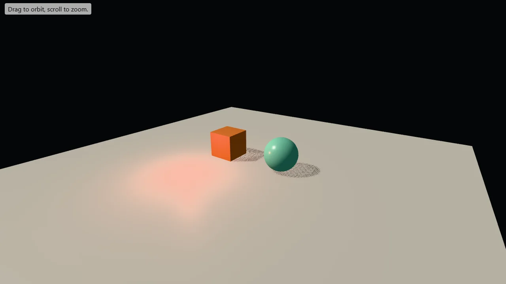

# Lights and shadows

You will aim the sun, add a moving lamp, and turn on soft shadows for a small scene. This takes about five minutes.



The engine has one sun (a directional light) and a small ambient light, both on by default. Every other light is an
optional package. Shadows are an optional package too, so a scene that does not use them pays nothing for them.

## 1. Make a scene to light

`stage.box` and `stage.sphere` make plain meshes. The stage is set up as in the [quickstart](../../README.md#quickstart);
this page replaces its `main.ts`.

```ts
import { createStage } from 'margoengine';
import { Clustered } from 'margoengine/clustered';
import { Shadows } from 'margoengine/shadows';

const stage = await createStage('#scene', { camera: { position: [5, 4, 7], target: [0, 0.8, 0] } });
const engine = stage.engine;
const floor = stage.box({ size: [14, 0.2, 14], position: [0, -0.1, 0], color: '#cfcfc8' });
const cube = stage.box({ position: [-1.2, 0.5, 0], color: '#d9824c' });
const ball = stage.sphere({ radius: 0.6, position: [1.2, 0.6, 0], color: '#84d6bd', roughness: 0.3 });
```

## 2. Aim and colour the sun

`engine.scene.lighting` holds the sun and the ambient light. Write to it and the next frame uses it.

```ts
const light = engine.scene.lighting;
light.direction.set([-4, 5, 3, 3]); // x, y, z point toward the light; the last number is its strength (default 3)
light.radiance.set([1, 0.93, 0.82, 0.15]); // red, green, blue of the sun (linear); the last number is ambient strength
```

The default is `direction [3, 5, 4, 3]` and `radiance [1, 1, 1, 0.15]`. `light.ambient` is a colour that multiplies the
ambient light; it is white by default.

## 3. Turn on shadows

`Shadows.attach` makes the sun cast shadows. Add each mesh that should cast one. Core meshes receive shadows without
being added.

```ts
const shadows = Shadows.attach(engine, { resolution: 2048 });
shadows.add(cube);
shadows.add(ball);
shadows.add(floor, { castShadow: false }); // the floor only receives, which saves a draw
```

## 4. Add a lamp

`Clustered` adds point and spot lights, up to 1,024. `setLights` replaces the whole list, so call it again each frame
to move a lamp. A lamp needs a finite `range` in world units (0 means unlimited).

```ts
const lamps = Clustered.attach(engine);
let time = 0;
stage.onTick((delta) => {
  time += delta;
  lamps.setLights([
    { position: [Math.cos(time) * 2.5, 1.2, Math.sin(time) * 2.5], range: 8, color: [1, 0.3, 0.2], intensity: 12 },
  ]);
});
```

## 5. Soften or sharpen the shadow edge

Most shadow values are read every frame from `shadows.options`, so you can change them while the scene runs. `filter`
and `cascades` are the exceptions: set them in `Shadows.attach(engine, { ... })`.

```ts
shadows.options.lightSize = 0.05; // wider soft edge (default 0.02)
shadows.options.normalBias = 0.03; // push the receiver off the surface to stop speckles (default 0.02)
```

## Options you will use

| Option | What it does | Default |
| --- | --- | --- |
| `resolution` | Shadow map size in texels (a number, or `[width, height]`). | 2048 |
| `distance` | Farthest shadowed distance from the camera, in world units. | 500 |
| `cascades` | Number of map layers, 1 to 4. Fewer is faster and coarser. | 4 |
| `filter` | `'soft'` (penumbra grows with distance), `'pcf'` (cheaper) or `'hard'`. | `'soft'` |
| `lightSize` | Width of the soft edge for `'soft'`. | 0.02 |
| `bias`, `normalBias` | Fix speckled surfaces; too large floats shadows off the ground. | 0.0005, 0.02 |
| `add(mesh, { static: true })` | Cache a caster that never moves. Call `shadows.invalidate()` if it does move. | `false` |

Every shadow option, the point light shadows (`@margoengine/clustered/shadows`), area lights and image-based lighting
are in the [shadows](../../packages/shadows/README.md), [clustered](../../packages/clustered/README.md) and
[environment](../../packages/environment/README.md) READMEs.

## Common mistakes

- **No shadow appears.** A mesh casts only after `shadows.add(mesh)`. Check the sun points toward the scene: a sun
  below the floor casts nothing useful.
- **Surfaces are speckled.** Raise `normalBias` a little. If shadows detach from their objects, you went too far.
- **The shadow is blocky.** Use a higher `resolution` or a smaller `distance`; the map is spread over the distance.
- **The shadow memory is large.** The default four 2048 maps use 128 MiB of GPU memory. On phones use `resolution: 1024`
  or `cascades: 2`.
- **A lamp lights nothing.** `range` must be large enough to reach the mesh, and `intensity` is not zero.
- **Shadows need WebGPU.** They are not drawn by the WebGL2 fallback.

## Next

- Orbit, fly or walk around the scene: [camera and controls](camera-and-controls.md).
- Click things in it: [interaction](interaction.md).
- Soft ambient light from an HDR image, fog and sky: the [environment](../../packages/environment/README.md) and
  [sky](../../packages/sky/README.md) packages.
