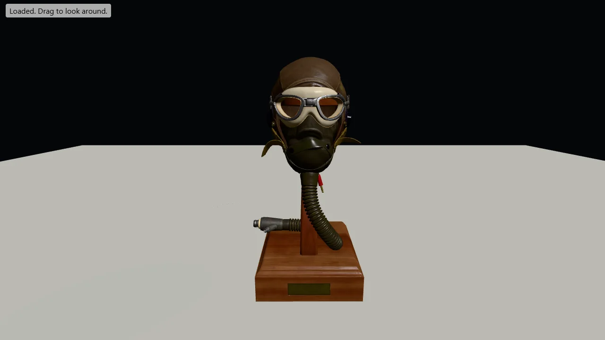

# Loading glTF models

You will load a textured glTF model, frame it with the camera, put it on a floor with a shadow, and release it when you
are done. This takes about five minutes.



glTF is the standard 3D format for the web. A `.glb` file holds the geometry, the textures and the materials in one
file. Margo loads it with `@margoengine/gltf-pro`, which draws the metallic-roughness materials glTF defines
(base colour, metal and roughness, normal, occlusion and emissive maps).

## 1. Get a model

This guide uses the Flight Helmet from the Khronos sample models (CC0, 5.5 MB). Copy
`examples/assets/flight-helmet.glb` from this repository to `public/models/` in your quickstart project. Any `.glb` or
`.gltf` file works. This page replaces `main.ts` in the [quickstart](../../README.md#quickstart) project.

## 2. Load it

`loadGLTF(engine, url)` fetches the file, decodes it and adds it to the scene. It returns a `PBRModel`. Pass a
`signal` to cancel a slow load.

```ts
import { createStage } from 'margoengine';
import { loadGLTF } from 'margoengine/gltf-pro';

const status = document.querySelector('#status')!;
const stage = await createStage('#scene', { camera: { position: [0, 1.2, 3], target: [0, 0.5, 0] } });
const engine = stage.engine;
const cancel = new AbortController(); // call cancel.abort() to stop a load that is no longer wanted
status.textContent = 'Loading the helmet...';
const model = await loadGLTF(engine, '/models/flight-helmet.glb', { signal: cancel.signal });
status.textContent = 'Loaded. Drag to look around.';
```

## 3. Stand it on the ground and frame it

`model.root` is the model's top node. Move, turn and scale the model through it. `model.bounds` holds the
world-space box as `[minX, minY, minZ, maxX, maxY, maxZ]`, read fresh each time. `fitToBoundingBox` moves the camera
back until a box fits.

```ts
model.root.setPosition([0, -model.bounds[1], 0]); // lift it so its lowest point is at y = 0
const b = model.bounds;
engine.camera.fitToBoundingBox([b[0], b[1], b[2]], [b[3], b[4], b[5]]);
```

## 4. Add a floor and a shadow

`shadows.add(model)` makes the model cast and receive shadows from the sun. It returns a function that removes it.

```ts
import { Shadows } from 'margoengine/shadows';

const floor = stage.box({ size: [6, 0.1, 6], position: [0, -0.05, 0], color: '#d4d4cc' });
const shadows = Shadows.attach(engine, { resolution: 2048 });
const removeShadow = shadows.add(model);
shadows.add(floor, { castShadow: false });
```

## 5. Release it

`model.destroy()` frees the model's GPU memory. `stage.dispose()` frees everything the stage made, including loaded
models, so call it when your page or component goes away.

```ts
window.addEventListener('pagehide', () => stage.dispose(), { once: true });
// To remove only the helmet later: removeShadow(); model.destroy();
```

## What `loadGLTF` handles

| Feature | Behaviour |
| --- | --- |
| `.glb`, `.gltf` with external files | Both load. External buffers and images resolve relative to the file's URL. |
| Draco, Meshopt and KTX2 compression | Decoded automatically. Draco and KTX2 use workers that start only when a file needs them. |
| Cameras, lights, node visibility | Read into `model.cameras`, `model.lights` and each node's `visible`. |
| Animation and skins | Played by [the animation package](animation.md). |
| Required extensions the loader does not know | The load rejects. |

`addGLTF(stage, url)` (from `@margoengine/stage/gltf`) fits the camera for you. Plain static opaque constant-colour
triangles use `@margoengine/gltf`. Textures, transparency, emission, vertex colours, points/lines, extensions and
other advanced geometry use `@margoengine/gltf-pro`. Skins, morph targets and animation clips additionally require
`@margoengine/animation`; the returned player starts paused. Install only the packages your files need. A missing
package rejects with `code: 'state'`, naming the file feature and the package to install, before adding scene nodes.
The basic path has no `model.pbr`; advanced models expose it. See [loader selection](../stage-gltf-routing.md).

## Common mistakes

- **The model is tiny or huge.** glTF units are metres. Frame it with `fitToBoundingBox`, or scale `model.root`. A
  model only a few centimetres across (the Khronos BoomBox is 2 cm) is framed from the camera's 10 cm near plane; it
  still casts its shadow, at any scale. To see a tiny model larger, lower `engine.camera.near` before framing it.
- **The model is dark.** Without an environment, glTF materials get a simple sky and ground fill plus the sun. Add
  image-based lighting from the [environment](../../packages/environment/README.md) package for glossy models.
- **A 404 or "Unexpected token <".** The URL is wrong and the server sent an HTML page. Files in Vite's `public/`
  folder are served from `/`, so `public/models/a.glb` is `/models/a.glb`.
- **Loading blocks for seconds on a big file.** Use `loadGLTFInWorker` from `margoengine/gltf-pro/worker`, which parses in a worker.
- **Leaks after navigation.** Call `stage.dispose()` or `model.destroy()`.

## Next

- Play the model's animations: [animation](animation.md).
- Click its parts: [interaction](interaction.md). `Picking` finds loaded models automatically; `hit.model` is the model
  and `hit.mesh` is the part.
- All loaders, including FBX, OBJ, STL and USDZ: [package catalog](../../README.md#packages).
