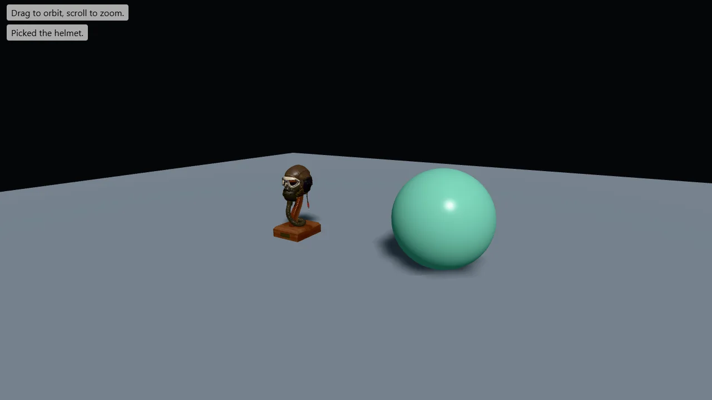

# React: your first scene

You will build a textured, lit scene with shadows, orbit controls and click-to-select in React, in about five minutes.
You get a helmet with its textures, a floor, a ball, the sun's shadows, and a status line that names what you clicked.



Margo's React package has no custom reconciler: `<Canvas>` makes one engine, and the components inside it are plain React
components that edit that engine. The package needs WebGPU for models, shadows and picking.

## 1. Set up a project

The packages are not on npm yet, so follow the [Install](../../README.md#install) section of the main README (Route 2) to
get the `.tgz` files, then:

```sh
mkdir my-react-app && cd my-react-app
npm init -y
npm pkg set type=module
npm install ../margoengine/test-results/*.tgz react react-dom vite @vitejs/plugin-react typescript @types/react @types/react-dom
```

Copy `examples/assets/flight-helmet-mobile.glb` from the repository to `public/models/` in your project. Save the
`index.html` of the [quickstart](../../README.md#quickstart), change its script line to `./main.tsx`, and put the code
below in `main.tsx` (the first block has the imports; the three blocks are one file). Start it with `npx vite`.

## 2. The scene

A `Model` loads a glTF file with its textures. `castShadow` puts it in the shadow map. `Plane` and `Sphere` are
convenience components with a plain colour. `Shadows` turns on the sun's shadows. `OrbitControls` binds the mouse.

```tsx
import { Suspense, useState } from 'react';
import { createRoot } from 'react-dom/client';
import { Canvas, OrbitControls, Plane, Shadows, Sphere, Stage } from 'margoengine/react';
import { Model } from 'margoengine/react/gltf-pro';

function Scene({ onPick }: { onPick: (name: string) => void }) {
  return (
    <Canvas style={{ height: '100vh' }} camera={{ position: [1.7, 1.2, 2.6], target: [0.1, 0.45, 0] }}>
      <Stage>
        <Shadows resolution={2048} />
        <Plane args={[12, 12]} rotation={[-Math.PI / 2, 0, 0]} color="#8d9aa6" />
        <Suspense fallback={null}>
          <Model src="/models/flight-helmet-mobile.glb" position={[-0.6, 0, 0]} castShadow onClick={() => onPick('helmet')} />
        </Suspense>
        <Sphere args={[0.4, 48, 24]} position={[0.9, 0.4, 0]} color="#84d6bd" roughness={0.25} castShadow onClick={() => onPick('ball')} />
        <OrbitControls enableDamping />
      </Stage>
    </Canvas>
  );
}
```

## 3. Keep the selection in state and mount the page

The selection is something a person reads, so it is React state. Picking is asynchronous: `onPick` runs a frame or two
after the click, when the GPU has answered which mesh is under the pointer.

```tsx
function Page() {
  const [picked, setPicked] = useState<string | null>(null);
  return (
    <>
      <Scene onPick={setPicked} />
      <p id="doc-status" style={{ position: 'fixed', top: 44, left: 12, margin: 0, padding: '4px 8px', background: '#fffa', borderRadius: 4 }}>
        {picked ? `Picked the ${picked}.` : 'Click the helmet or the ball. Drag to orbit.'}
      </p>
    </>
  );
}
createRoot(document.querySelector('#scene')!).render(<Page />);
```

## What you should see

A helmet and a ball standing on a grey floor, each with a soft shadow. A click on one changes the status line. A drag
orbits the camera and does not change the status line.

## Options you will use

| Component | Prop | Default |
| --- | --- | --- |
| `Canvas` | `camera`, `backend` (`'auto'`, `'webgpu'`, `'webgl2'`), `frameloop` (`'always'`, `'demand'`) | auto, always |
| `Shadows` | `resolution`, `distance`, `filter`, `bias` | the shadow package defaults |
| `Model` | `src`, `position`, `rotation`, `scale`, `castShadow`, `receiveShadow`, `onClick`, `materials` | receive: true |
| `Sphere`, `Box`, `Plane` | `args`, `color`, `roughness`, `metalness`, `castShadow`, `onClick` | plain material |

## Common mistakes

- **A blank canvas with no height.** Give `Canvas` a height: `style={{ height: '100vh' }}`.
- **A test reads the selection right after the click.** Picking is asynchronous; wait for the status text to change.
- **A texture on `Box` or `Sphere`.** These components take a colour only. Put textures on a glTF `Model`, or create the
  mesh yourself with `createMesh` from `margoengine/materials` inside an effect (see the
  [textures guide](textures-and-materials.md)).
- **Clicks on a group do nothing.** Events do not bubble; put `onClick` on the drawn mesh.

## Next

- Why the selection is state and the motion is a ref: [state vs the frame loop](react-state-vs-frame-loop.md).
- Save and load the scene as JSON with undo: [the scene document](react-scene-document.md).
- Every component and hook: the [React package README](../../packages/react/README.md).
