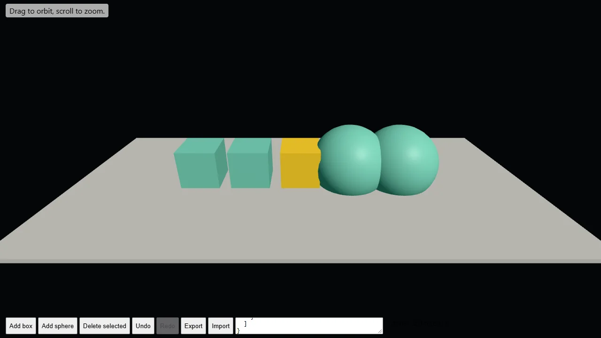

# React: build the scene from a document

You will build a tiny scene editor whose whole state is one plain JSON document. Adding, deleting, undo, redo, saving and
loading all fall out of that. This takes about ten minutes.



The pattern: **render the scene from a plain, serialisable document, and never serialise engine objects.** The document
holds numbers, strings and arrays. Meshes, materials and GPU buffers are what React draws from it, and they are never
stored or saved. Selection, hover and other screen-only state stay outside the document, so they do not end up in a
save file or an undo step.

## 1. Define the document and check untrusted input

A saved file is untrusted input. `parseDoc` rejects anything that is not a version 1 document and says why. Install
`react` and `react-dom`, save the code as `main.tsx`, and point the quickstart's `index.html` at it, as in
[React: state or the frame loop?](react-state-vs-frame-loop.md).

```tsx
import { useState } from 'react';
import { createRoot } from 'react-dom/client';
import { Box, Canvas, OrbitControls, Sphere, Stage } from 'margoengine/react';

type Vec3 = [number, number, number];
interface Item {
  id: number;
  shape: 'box' | 'sphere';
  position: Vec3;
  color: string;
}
interface SceneDoc {
  version: 1;
  items: Item[];
}

function parseDoc(text: string): SceneDoc {
  const data = JSON.parse(text);
  if (data?.version !== 1 || !Array.isArray(data.items)) throw new Error('Not a version 1 scene document.');
  for (const item of data.items) {
    const valid =
      Number.isInteger(item?.id) &&
      (item.shape === 'box' || item.shape === 'sphere') &&
      typeof item.color === 'string' &&
      Array.isArray(item.position) &&
      item.position.length === 3 &&
      item.position.every(Number.isFinite);
    if (!valid) throw new Error(`Item ${String(item?.id)} is not valid.`);
  }
  return data as SceneDoc;
}
```

## 2. Keep the history of documents

Undo and redo are three lists of documents. Every edit builds a new document instead of changing the old one, so a
saved step can never be altered by later edits.

```tsx
function useHistory(first: SceneDoc) {
  const [h, setH] = useState({ past: [] as SceneDoc[], now: first, future: [] as SceneDoc[] });
  return {
    doc: h.now,
    canUndo: h.past.length > 0,
    canRedo: h.future.length > 0,
    commit: (doc: SceneDoc) => setH((s) => ({ past: [...s.past, s.now], now: doc, future: [] })),
    undo: () => setH((s) => (s.past.length ? { past: s.past.slice(0, -1), now: s.past[s.past.length - 1], future: [s.now, ...s.future] } : s)),
    redo: () => setH((s) => (s.future.length ? { past: [...s.past, s.now], now: s.future[0], future: s.future.slice(1) } : s)),
  };
}
```

## 3. Render the scene from the document

`Box` and `Sphere` take a position and a colour. The selected item is drawn in a highlight colour at render time. That
colour is not in the document.

```tsx
function Editor() {
  const { doc, canUndo, canRedo, commit, undo, redo } = useHistory({ version: 1, items: [] });
  const [selected, setSelected] = useState<number | null>(null);
  const [text, setText] = useState('');
  const [message, setMessage] = useState('Add something, then click it.');
  const nextId = doc.items.reduce((most, item) => Math.max(most, item.id), 0) + 1;
  const add = (shape: Item['shape']) =>
    commit({ ...doc, items: [...doc.items, { id: nextId, shape, position: [((nextId - 1) % 5) * 1.3 - 2.6, 0.5, 0], color: '#84d6bd' }] });
  return (
    <>
      <Canvas style={{ height: '100vh' }} camera={{ position: [0, 4, 7], target: [0, 0.3, 0] }}>
        <Stage>
          <OrbitControls enableDamping />
          <Box args={[12, 0.1, 6]} position={[0, -0.05, 0]} color="#cfcfc8" />
          {doc.items.map((item) => {
            const props = {
              position: item.position,
              color: item.id === selected ? '#ffd54a' : item.color,
              onClick: () => setSelected(item.id), // fires after the GPU pick finishes, not during the click
            };
            return item.shape === 'box' ? <Box key={item.id} {...props} /> : <Sphere key={item.id} {...props} />;
          })}
        </Stage>
      </Canvas>
      <div style={{ position: 'fixed', bottom: 8, left: 12, right: 12, display: 'flex', flexWrap: 'wrap', gap: 4 }}>
        <button onClick={() => add('box')}>Add box</button>
        <button onClick={() => add('sphere')}>Add sphere</button>
        <button disabled={selected === null} onClick={() => { commit({ ...doc, items: doc.items.filter((i) => i.id !== selected) }); setSelected(null); }}>Delete selected</button>
        <button disabled={!canUndo} onClick={undo}>Undo</button>
        <button disabled={!canRedo} onClick={redo}>Redo</button>
        <button onClick={() => setText(JSON.stringify(doc, null, 2))}>Export</button>
        <button onClick={() => { try { commit(parseDoc(text)); setSelected(null); setMessage('Loaded.'); } catch (error) { setMessage(String(error)); } }}>Import</button>
        <textarea aria-label="Scene JSON" value={text} onChange={(e) => setText(e.target.value)} rows={2} cols={40} />
        <span id="doc-status">{doc.items.length} items. {selected === null ? message : `Selected ${selected}.`}</span>
      </div>
    </>
  );
}
createRoot(document.querySelector('#scene')!).render(<Editor />);
```

## Why this holds up

- **Save and load are `JSON.stringify` and `parseDoc`.** No engine object is ever written, so a file does not depend on
  engine versions or GPU state.
- **Undo is cheap and safe.** Documents are replaced, not edited.
- **The scene cannot drift from the data.** The document is the only source. If a mesh looks wrong, the document is
  wrong, and you can print it.
- **Per-frame motion still uses refs.** A running animation is not document data; see
  [state or the frame loop](react-state-vs-frame-loop.md).

## Common mistakes

- **Storing mesh refs or `Mesh` objects in the document or in state.** They cannot be saved and they hold GPU objects.
- **Editing the document in place.** `items.push(...)` does not trigger a render and breaks undo. Build a new document.
- **Trusting a loaded file.** Check every field, as `parseDoc` does, before it reaches the scene.
- **Reading `selected` right after a click.** Picking is asynchronous: the handler runs after the GPU finishes, a frame or
  two later. See [interaction](interaction.md#picking-is-asynchronous).

## Next

- Dragging items: [interaction](interaction.md) and the `DragControls` in the [controls README](../../packages/controls/README.md).
- Load models instead of boxes: [loading glTF](loading-gltf.md).
- Every component and hook: the [React package README](../../packages/react/README.md).
