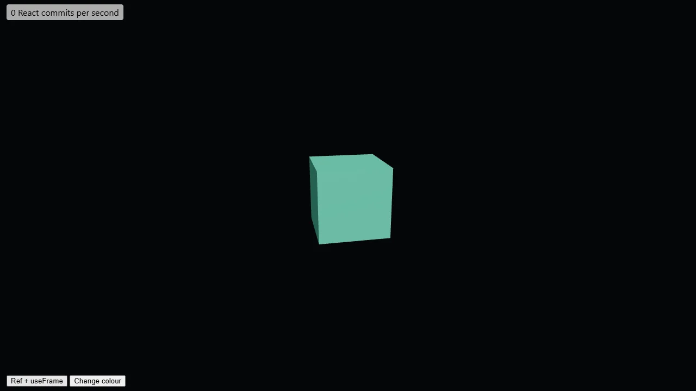

# React: state or the frame loop?

You will spin a cube two ways, count how often React re-renders for each, and learn the rule for what goes in React
state and what does not. This takes about five minutes.



Margo's React package has no custom reconciler. A component that changes state re-renders as React always does, and
every re-render walks your component tree again. Per-frame motion does not need that.

## The rule

- **Per-frame motion, mouse tracking and transforms:** write them to a ref inside `useFrame`. No `setState` there.
- **UI toggles, colour choices, loading flags and inspector values:** keep them in React state.

`useFrame((engine, deltaSeconds) => { ... })` runs once per rendered frame. It does not re-render anything, and it does
not re-subscribe when your callback changes.

## 1. Set up a page that counts commits

React's `Profiler` calls `onRender` each time its subtree commits. This page counts them and shows commits per second.
Install `react` and `react-dom`, save the code below as `main.tsx`, and change the script in the quickstart's
`index.html` to `./main.tsx` (the `#scene` and `#status` elements stay).

```tsx
import { Profiler, useRef, useState } from 'react';
import { createRoot } from 'react-dom/client';
import { BoxGeometry, Canvas, Mesh, type MeshRef, PbrMaterial, Stage, useFrame } from 'margoengine/react';

let commits = 0; // React commits since the counter was last read
const count = () => {
  commits++;
};

/** Writes the commit rate into the page once a second, from the frame loop and without React state. */
function Meter() {
  const since = useRef(performance.now());
  useFrame(() => {
    const now = performance.now();
    if (now - since.current < 1000) return;
    document.querySelector('#status')!.textContent = `${Math.round((commits * 1000) / (now - since.current))} React commits per second`;
    commits = 0;
    since.current = now;
  });
  return null;
}
```

## 2. The state-driven way (avoid)

Every frame calls `setAngle`, so React re-renders this component once per frame.

```tsx
function StateCube({ color }: { color: string }) {
  const [angle, setAngle] = useState(0);
  useFrame((_, delta) => setAngle((a) => a + delta));
  return (
    <Mesh rotation={[0, angle, 0]} position={[0, 0.5, 0]}>
      <BoxGeometry />
      <PbrMaterial color={color} />
    </Mesh>
  );
}
```

## 3. The ref way (use this)

The ref holds the mesh and `useFrame` writes its rotation. React renders the component once.

```tsx
function RefCube({ color }: { color: string }) {
  const mesh = useRef<MeshRef>(null);
  useFrame((_, delta) => {
    if (mesh.current) mesh.current.rotation.y += delta;
  });
  return (
    <Mesh ref={mesh} position={[0, 0.5, 0]}>
      <BoxGeometry />
      <PbrMaterial color={color} />
    </Mesh>
  );
}
```

## 4. Keep the choices in state and mount the page

Which cube to show and which colour to use change when a person clicks, so they are state. A click re-renders once.

```tsx
function Page() {
  const [stateDriven, setStateDriven] = useState(false);
  const [color, setColor] = useState('#84d6bd');
  return (
    <>
      <Canvas style={{ height: '100vh' }} camera={{ position: [2.5, 2, 4], target: [0, 0.5, 0] }}>
        <Stage>
          <Profiler id="cube" onRender={count}>
            {stateDriven ? <StateCube color={color} /> : <RefCube color={color} />}
          </Profiler>
          <Meter />
        </Stage>
      </Canvas>
      <p style={{ position: 'fixed', bottom: 8, left: 12, margin: 0 }}>
        <button onClick={() => setStateDriven(!stateDriven)}>{stateDriven ? 'State-driven' : 'Ref + useFrame'}</button>{' '}
        <button onClick={() => setColor(color === '#84d6bd' ? '#e45630' : '#84d6bd')}>Change colour</button>
      </p>
    </>
  );
}
createRoot(document.querySelector('#scene')!).render(<Page />);
```

## What you should see

With "Ref + useFrame" the status line (top left) shows 0 commits per second, apart from the moment you click. Click the
first button to switch to the state-driven cube and it shows about as many commits as frames per second. The page counts
React work, not milliseconds, so it makes no claim about speed. Use the [stats](../../packages/stats/README.md) package
to time frames in your own scene.

## Common mistakes

- **`setState` inside `useFrame` or `requestAnimationFrame`.** Use a ref and write to it.
- **Reading a ref in render.** The ref changes without a render, so the text goes stale. Write it from the frame loop or
  a timer, as `Meter` does.
- **A changing number in props every frame** (`<Mesh position={[x, 0, 0]}>` with `x` in state). Pass the first value in
  props and move the mesh through its ref.
- **A new object or function in props on every render.** It re-renders children. Define constants outside the
  component or use `useMemo`.
- **Updating a mesh in `useEffect`.** Effects run after a render, not once per frame. Use `useFrame`.

## Next

- Recipes for models, physics and post-processing: the [React cookbook](../react-cookbook.md).
- Every component and hook: the [React package README](../../packages/react/README.md).
- Coming from react-three-fiber: [the migration guide](../react-from-r3f.md).
