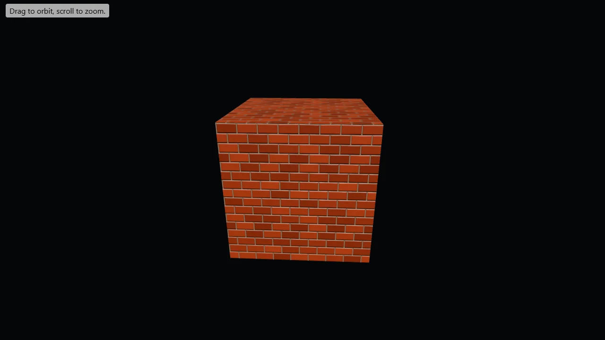

# Textures and materials

You will put a brick texture with a bumpy surface on a box, then change how shiny and how repeated it is. This takes
about five minutes.



You need the project from the [quickstart](../../README.md#quickstart). This page replaces its `main.ts`. The brick
images are in `examples/assets/docs/`; copy that folder to `public/textures/` in your project. Any PNG or JPEG works.

## 1. Load a texture

`loadTexture` fetches an image and returns a `Texture`. Colour images are read as sRGB. Set `wrapS` and `wrapT` to
`'repeat'` if the image will tile; the default is `'clamp'`, which stretches the edge pixels.

```ts
import { createStage } from 'margoengine';
import { boxGeometry } from 'margoengine/geometry';
import { PbrMaterial, createMesh, loadTexture } from 'margoengine/materials';

const stage = await createStage('#scene', { camera: { position: [2.6, 1.8, 3.6], target: [0, 0, 0] } });
const bricks = await loadTexture('/textures/bricks.png', { wrapS: 'repeat', wrapT: 'repeat' });
```

## 2. Put it on a material and a mesh

A `PbrMaterial` is the standard physically based material. `map` is the base colour. `createMesh` draws a geometry
with a material. Geometry comes from `margoengine/geometry`; every primitive there has UV coordinates.

```ts
const wall = new PbrMaterial({ map: bricks, roughness: 0.8 });
const box = createMesh(stage.engine, boxGeometry(2, 2, 2), wall);
```

## 3. Add a normal map

A normal map fakes small bumps without more triangles. It holds directions, not colours, so it is read as linear data
(the engine does this for you in the `normalMap` slot). `normalScale` sets how strong the bumps look; the default is 1.

```ts
const bumps = await loadTexture('/textures/bricks-normal.png', { wrapS: 'repeat', wrapT: 'repeat' });
wall.normalMap = bumps;
wall.normalScale = 1.5;
```

## 4. Repeat the texture

`setUVTransform` changes the texture coordinates of every map on the material at once. `scale: [2, 2]` shows the
image twice across each face. `offset` slides it and `rotation` turns it, in radians.

```ts
wall.setUVTransform({ scale: [2, 2] });
```

## 5. Change the look while it runs

Material values are live: set one and the next frame shows it. `color` multiplies the map. Colour strings and numbers
are sRGB.

```ts
wall.color = '#ffd9c2'; // tint
wall.roughness = 0.5; // 0 is a mirror, 1 is chalk (default 1 for a PbrMaterial)
wall.metalness = 0; // 0 for brick, 1 for bare metal (default 0)
stage.onTick((delta) => {
  box.root.rotation.y += delta * 0.4;
});
```

## Options you will use

| Option | What it does | Default |
| --- | --- | --- |
| `map` | Base colour image. | none |
| `color` | Colour that multiplies `map`. | white |
| `roughness`, `metalness` | Surface values, 0 to 1. | 1 and 0 |
| `normalMap`, `normalScale` | Fine surface bumps and their strength. | none, 1 |
| `metalRoughnessMap` | One image with roughness in green and metalness in blue, as in glTF. | none |
| `aoMap`, `emissiveMap`, `alphaMap` | Baked shadowing, glowing parts, per-pixel opacity. | none |
| `Texture` `wrapS`, `wrapT` | `'repeat'`, `'clamp'` or `'mirror'`. | `'clamp'` |
| `Texture` `magFilter`, `minFilter` | `'linear'` or `'nearest'`. Use `'nearest'` for pixel art. | `'linear'` |
| `Texture` `anisotropy` | Sharper textures at a slant, 1 or more. | 1 |

Every option, including clear coat, sheen, transparency and node materials, is in the
[materials README](../../packages/materials/README.md).

## Common mistakes

- **The texture looks stretched at the edges.** `wrapS` and `wrapT` are `'clamp'` unless you set `'repeat'`.
- **The surface is black or flat.** The scene needs a light. The default sun is on; if you changed
  `engine.scene.lighting`, see [lights and shadows](lights-and-shadows.md).
- **A normal map makes the surface look inside out.** Normal maps follow the OpenGL convention (green points up). Flip
  the green channel in your image editor if yours was made for DirectX.
- **A texture is gone after `dispose()`.** Textures belong to you, not to the material. Dispose one only after no
  material uses it.
- **Nothing appears on a phone browser with no WebGPU.** Textured materials need WebGPU; the
  [WebGL2 fallback](../../packages/webgl/README.md) draws plain meshes only.

## Next

- Light and shadow the scene: [lights and shadows](lights-and-shadows.md).
- Move the camera: [camera and controls](camera-and-controls.md).
- Load a finished model with its own textures: [loading glTF](loading-gltf.md).
