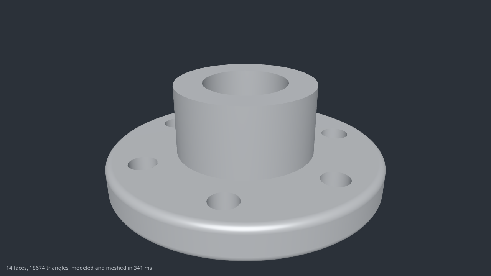

# B-rep examples

These use `@margoengine/brep`, the exact-geometry CAD kernel in `packages/brep`. Lengths are in metres.

Build the packages once from the repo root:

```sh
npm run build:packages
```

## Model a part and write STEP (Node)

```sh
node examples/brep/model-to-step.mjs plate.step
```

Builds a 60 x 40 x 10 mm plate, rounds its four vertical edges, drills four holes, writes the solid to STEP,
reads the file back, meshes it and checks the volume survives the round trip. Output looks like:

```
modeled: volume 22731.7 mm^3, area 7231.6 mm^2
STEP: 22729 bytes
body 0: 14 faces, 460 triangles, 0 failed faces
read back: volume 22731.7 mm^3
```

## Flange in the browser

`flange.js` builds a pipe flange from cylinders: a disc, a hub, a bore and six bolt holes, with the outer edge
filleted. `../brep-flange.html` models it in the page, writes and reads STEP, meshes the exact surfaces and draws
the result with the stage.

```sh
npm run build:packages
npm run dev:examples
# open http://127.0.0.1:5173/examples/brep-flange.html
```


