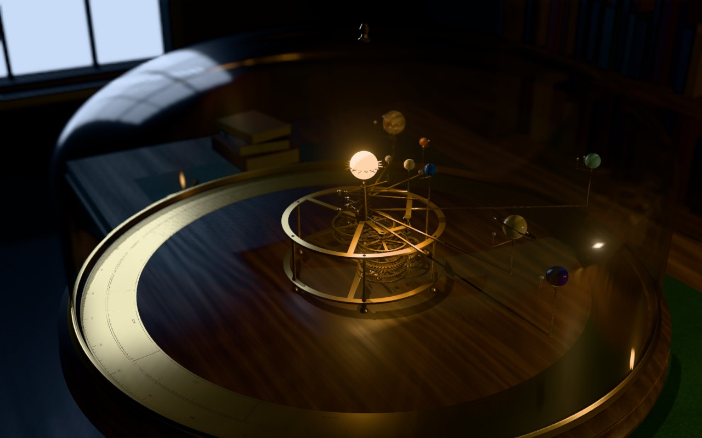

# Orrery



A large brass and walnut clockwork orrery of the solar system under a glass dome, in a dim study lit by a window and a
desk lamp. Pick any date from 1800 to 2049 and the eight planets turn to where they really were on that day, seen from
the Sun. Play time forward at one day a second, up to a century in ten seconds, and every wheel of the gear trains
turns with them.

Everything in the scene was made for this page from Margo Engine and Blender: no downloaded model, texture, light
probe image or font file. [blender/build_orrery.py](blender/build_orrery.py) builds the whole study from numbers,
and [main.ts](main.ts) drives it.

## What it shows

| Feature | Package |
| --- | --- |
| Brass, steel and stone PBR, walnut and leather with clearcoat, loaded from glTF with Draco geometry | `@margoengine/gltf-pro`, `@margoengine/decoders` |
| Reflections and bounce light baked from the study itself: a box probe for the room, one for the mechanism, an irradiance volume | `@margoengine/environment/probes` |
| The glass dome, two surfaces thick, order independent | `@margoengine/oit` |
| Window sunlight with soft cascaded shadows, contact shadows | `@margoengine/shadows`, `@margoengine/post/contact-shadows` |
| The desk lamp, and a lamp inside the Sun that lights the planets' day sides | `@margoengine/clustered` |
| Depth of field that racks focus to whatever you click | `@margoengine/dof`, `@margoengine/dof/autofocus` |
| Bloom on the Sun and the highlights, PBR Neutral tone mapping | `@margoengine/post/bloom`, `@margoengine/tonemap` |
| Temporal anti-aliasing and upscaling of the fine teeth | `@margoengine/taa/upscale` |
| Click a planet to fly to it, outlines, and an x-ray of the gear trains through the frame | `@margoengine/controls/transitions`, `@margoengine/selection` |
| Planet names, for the chosen planet or all with Names | `@margoengine/labels` |
| Light tier on slower GPUs, frame pacing | `@margoengine/quality` |

It runs on WebGPU, and on browsers without it through the WebGL2 compatibility layer (`examples/needs-webgpu.js`),
which leaves out only what that device refuses by name.

Controls: the date box, Today, Play and the speed menu; the slider scrubs 1800 to 2050. Drag to orbit, wheel to
zoom, click a planet to fly in, click anything else to focus there. Lift the dome, Gear trains (x-ray), Names and
Whole orrery are at the top right. `?date=YYYY-MM-DD` opens on a date; `?ui=0` hides the controls for a still.

## Run it

From the repository root, after `npm ci` and `npm run build:packages`:

```sh
npm run dev:examples
# http://127.0.0.1:5173/examples/orrery/index.html
```

Checks: `node --test tests/orrery-ephemeris.test.js tests/orrery-gears.test.js` (no GPU) and `npm run test:orrery`
(a real browser, add `-- --compat` for the WebGL2 layer): the page loads with no console error and a picture that is
not blank, every arm sits at its planet's computed longitude and every wheel at its train angle for two dates, a
planet flies in, time plays, reduced motion holds it still, the phone layout fits and a missing model is reported.

## The astronomy

Each planet's heliocentric ecliptic longitude comes from published mean orbital elements solved with Kepler's
equation ([ephemeris.ts](ephemeris.ts)):

- Elements: E. M. Standish, "Keplerian Elements for Approximate Positions of the Major Planets", JPL Solar System
  Dynamics, Table 1, fitted to DE405 over 1800 to 2050, mean ecliptic and equinox of J2000
  (https://ssd.jpl.nasa.gov/planets/approx_pos.html). Earth is the Earth-Moon barycentre, as in the table.
- Method: the six elements at the date (value plus rate times Julian centuries from J2000); mean anomaly M = L - varpi;
  Kepler's equation E - e sin E = M by Newton's method to 1e-12 rad; the position in the orbit plane rotated by the
  argument of perihelion, inclination and node into the ecliptic; longitude = atan2(y, x).
- The Moon, on Earth's arm, uses the low-precision lunar longitude of the Astronomical Almanac (six periodic terms),
  moved from the equinox of date to J2000 by general precession.

Accuracy, measured against an independent reference: JPL Horizons state vectors (ephemeris DE441, retrieved
2026-11-13) at 51 dates five years apart from 1800 to 2050, in the same frame
([reference/horizons.json](reference/horizons.json), fetched by [reference/fetch-horizons.mjs](reference/fetch-horizons.mjs)).
Largest error over those dates, in arcminutes of longitude:

| Mercury | Venus | Earth | Mars | Jupiter | Saturn | Uranus | Neptune | Moon |
| --- | --- | --- | --- | --- | --- | --- | --- | --- |
| 0.38 | 0.42 | 0.33 | 1.15 | 7.6 | 11.9 | 1.7 | 0.98 | 16.8 |

Jupiter and Saturn are worst because their mutual pull is not in a Keplerian orbit; on the model a 12 arcminute error
is a fraction of a millimetre. `tests/orrery-ephemeris.test.js` holds every planet to these figures. The dates are
TDB; a UTC date differs by about a minute, far below these errors. Outside 1800 to 2050 the table is not fitted, so the
dial stops there.

## The clockwork

[gears.ts](gears.ts) designs the trains and [layout.ts](layout.ts) holds every dimension. The planets' tubes turn on
the central axis; a fixed stud arbor stands 78 mm from it and the drive arbor 62 mm from that, turning once every three
Earth years. Each planet has a two-stage train: a wheel on the drive arbor meshes a wheel on the stud arbor, a second
wheel on the same sleeve meshes the wheel on the planet's tube. The tooth counts (15 to 140) are found by an exhaustive
search for the ratio closest to the planet's rate of mean longitude over the drive's, among trains whose wheels fit the
frame and clear every arbor and tube they do not mesh with:

| Planet | a | b | c | d | Ratio error |
| --- | --- | --- | --- | --- | --- |
| Mercury | 125 | 22 | 114 | 52 | 1.6e-6 |
| Venus | 57 | 23 | 61 | 31 | 1.7e-6 |
| Earth | 36 | 18 | 39 | 26 | 0 |
| Mars | 25 | 32 | 49 | 24 | 5.9e-7 |
| Jupiter | 33 | 68 | 37 | 71 | 6.6e-7 |
| Saturn | 59 | 73 | 15 | 119 | 1.2e-6 |
| Uranus | 15 | 89 | 25 | 118 | 7.3e-7 |
| Neptune | 16 | 113 | 18 | 140 | 2.6e-5 |

Over 1800 to 2050 no wheel drifts more than 0.62 degrees from its planet's mean longitude. Wheels are cut with true
involute teeth (20 degree pressure angle, standard addendum and dedendum), each pair at the sum of its pitch radii, and
each driven wheel turned so its gaps meet the driver's teeth at every angle (`meshAngle`); the tests check all of it.

The wheels show each planet's mean motion, as an orrery's gears do. The arms show the true longitude: the difference,
the equation of the centre (up to 23.7 degrees for Mercury), is what a real orrery adds with a pin and slot. Axis tilts
stay fixed in space, so Saturn's rings turn edge on in 2025 as they did. Moons other than ours turn at their sidereal
periods from an arbitrary starting angle; only the Moon's position is computed. Orbit radii and sizes are not to scale.

## Rebuild the model

The model is [orrery.glb](orrery.glb), built in headless Blender 5.2.3:

```sh
node examples/orrery/blender/write-layout.mjs   # layout.ts -> blender/layout.json
blender --background --factory-startup --python-exit-code 1 --python examples/orrery/blender/build_orrery.py -- \
  --layout examples/orrery/blender/layout.json --out examples/orrery/orrery.glb
```

The wheels, plates, arms and planets are cut from `layout.json`; the calendar ring is engraved with a tick for every
degree and every day of 2026 at Earth's computed longitude, so reading the ring under Earth gives the date. Wood, leather,
stone and plaster are procedural node graphs baked to images with Cycles. Text uses Blender's built-in font. `--fast`
skips the bakes for a quick geometry check.
